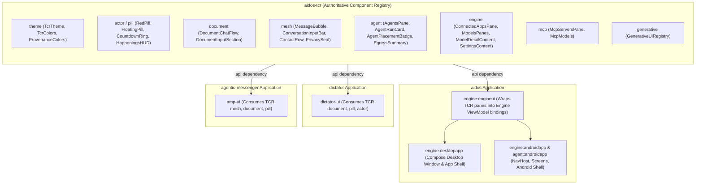

# Aidos Ecosystem UI Architecture & Component Manual

**Status:** Canonical Standard · Settled  
**Authority:** Aidos Architecture Council (Decisions D46, D48, D49, RFC-0051, RFC-0103, RFC-0104, RFC-0106)  
**Applicable Repositories:** `aidos-tcr`, `aidos`, `dictator`, `agentic-messenger`  
**Cross-Reference:** [aidos-tcr/UI_MANUAL.md](file:///C:/Users/jsilv/Code/aidos-tcr/UI_MANUAL.md) · [docs/TCR_COMPONENT_DOMAIN_OWNERS.md](file:///C:/Users/jsilv/Code/aidos/docs/TCR_COMPONENT_DOMAIN_OWNERS.md)

---

## 1. Executive Summary: The Non-Negotiable Rules

If you are an agent or developer touching ANY UI code in this ecosystem, memorize these four core principles:

1. **`aidos-tcr` is the Sole Authoritative Registry for Shared UI**:
   - Shared Compose Multiplatform UI components live **ONLY** in `aidos-tcr` (`dev.aidos.tcr.*`).
   - Consumer apps (`aidos`, `dictator`, `agentic-messenger`) are **pure consumers**. Never copy, fork, or reimplement a shared component in an app repo.
2. **`commonMain` for All Multiplatform Code**:
   - Models, UI state, presenters, and composables consumed by both Android and Desktop **MUST** be placed in `commonMain` (or `jvmAndAndroidMain` in `:engineui`).
   - **Never place shared Android-facing models or composables in `jvmMain`**. Doing so causes immediate compilation failures in Android release and debug builds.
3. **Strict Adherence to `TcrColors` and Tokens**:
   - Never use ad-hoc color literals (e.g. `Color(0xFF...)` or `Color.Red`) in app layouts.
   - Use semantic roles from `TcrColors` (`EmberRed`, `ElectricBlue`, `EmeraldGreen`, `AmberWarning`, `VioletProtocol`) and `TcrTheme`.
4. **Zero Broken Routes**:
   - Every destination registered in a `Routes.kt` or `NavHost.kt` must resolve to a valid, tested `@Composable` screen. Never leave dead placeholders or missing imports that break release compilation.

---

## 2. System Architecture



### The Role of `aidos-tcr`
The ultimate vision for Aidos is **Desktop Generative UI** (RFC-0051 / RFC-0106). Generative agents on an infinite spatial canvas orchestrate and assemble UI dynamically. **Generative UI must not generate raw, untrusted, or unstandardized controls from scratch.** Doing so causes layout breaks, hallucinated interactions, and accessibility failures.

Instead, Generative UI and application shells bind to pre-built, tested, and secure atomic components defined in `aidos-tcr`.

---

## 3. TCR Domain & Component Matrix

| Domain | Package | Key Composables & Models | Canonical Purpose |
|---|---|---|---|
| **Theme & Tokens** | `dev.aidos.tcr.theme` | `TcrTheme`<br>`TcrColors`<br>`ProvenanceColors`<br>`TcrShapes`<br>`TcrTypography` | Global semantic colors, dark/light Material3 themes, typography, and provenanced message colors. |
| **Actor & Caret Staging** | `dev.aidos.tcr.actor`<br>`dev.aidos.tcr.pill` | `PersistentRedPill`<br>`FloatingActorPill`<br>`RadialCountdownRing`<br>`HappeningsHUD`<br>`CadenceEngine`<br>`PillConstellationOverlay` | Caret actors, voice dictation HUD, auto-commit countdowns, cancellation triggers, and actor status indicators. |
| **Document Composition** | `dev.aidos.tcr.document` | `DocumentChatFlow`<br>`DocumentInputSection` | Active document tail, demarcation line, collaborative markdown editing, and streaming context insertion. |
| **Agent Telemetry & Runs** | `dev.aidos.tcr.agent` | `AgentsPane`<br>`AgentRunCard`<br>`AgentPlacementBadge`<br>`AgentEgressSummary`<br>`AgentBudgetMeter`<br>`AgentTaskGraphView`<br>`WorkerOutcomeCard` | Comprehensive agent dashboard, hierarchical subagent visualization, locality chips (Local, Cluster, Remote), zero-egress verification, and budget meters. |
| **Engine Host & Models** | `dev.aidos.tcr.engine` | `ConnectedAppsPane`<br>`ModelsPanes`<br>`ModelDetailContent`<br>`SettingsContent`<br>`StatusPane`<br>`EngineModels` | Aidos Engine control surfaces, model catalog, download/quantization details, connected apps authorization, and engine configuration. |
| **MCP Servers** | `dev.aidos.tcr.mcp` | `McpServersPane`<br>`McpModels` | MCP server connection inspect, tool listing, transport classification display, and operation adoption views. |
| **Conversation Mesh** | `dev.aidos.tcr.mesh` | `ConversationInputBar`<br>`MessageBubble`<br>`ContactRow`<br>`PrivacySealBadge`<br>`ApprovalCard`<br>`WaveformVisualizer`<br>`CueChip` | 4-party conversation UI (Human Direct, Agent Delegate, Human Only E2EE, System Service), audio waveforms, and disclosure cues. |
| **Generative Registry** | `dev.aidos.tcr.generative` | `GenerativeUiRegistry` | Dynamic component discovery and spatial canvas binding for generative layouts. |

---

## 4. Design System Tokens & Guidelines

### 4.1. Semantic Color Roles (`TcrColors`)
Always use these exact semantic color mappings:

* **`EmberRed` (`0xFFEF4444`)**: Voice dictation cursor, Red Pill, immediate cancel actions, and destructive confirmations.
* **`ElectricBlue` (`0xFF3B82F6`)**: Deterministic text editing, selection shelf, paragraph manipulation, and `CLUSTER` inference placement.
* **`EmeraldGreen` (`0xFF10B981`)**: Generative AI token streaming, autonomous completions, `LOCAL` on-device inference, and verified zero-egress badges.
* **`AmberWarning` (`0xFFF59E0B`)**: Progressive disclosure requests, pending human approvals, budget threshold warnings, and escalated capabilities.
* **`VioletProtocol` (`0xFF8B5CF6`)**: Cryptographic assertions, blinded envelope stamps, `REMOTE` API model placement, and token usage meters.

### 4.2. Animation Physics & Cadence
Defined in `CadenceEngine`:
* **Sinusoidal Idle Pulse**: 900ms ease-in-out period (`FastOutSlowInEasing`, alpha `0.4f` to `1.0f`) for idle agents and active listening carets.
* **Execution Snap**: 100ms crisp execution snap on timer or commit completion.
* **Drag Thresholds**: 
  - Dragging a pill **20dp** enters the paused state (countdown halts).
  - Dragging **80dp** tears and cancels the action.

---

## 5. Consumer Architecture: How App Repositories Use TCR

### 5.1. Engine UI (`aidos:engine:engineui`)
`engine:engineui` is a Compose Multiplatform library (`jvmAndAndroidMain`) that bridges Aidos Engine domain state to TCR components:
- **Rule**: `engineui` handles the ViewModel / State mapping.
- **Rule**: Do NOT write custom visual elements in `engineui` if they belong in TCR. For example, `AgentsPane` in `engineui` imports `dev.aidos.tcr.agent.*` and lays out `AgentRunCard`, `AgentStatsBanner`, and `AgentPlacementBadge`.

### 5.2. Desktop Application (`aidos:engine:desktopapp`)
- The desktop app shell is located in `DesktopApp.kt`.
- It sets up a Compose Desktop window with navigation side-rail or tabs matching the `engineui` panes (`Status`, `Models`, `Connected Apps`, `Agents`, `MCP Servers`, `Settings`).

### 5.3. Android Applications (`engine:androidapp` & `agent:androidapp`)
- The Android apps use `NavHost` and Jetpack Compose navigation.
- Screens embed `engineui` panes inside standard Android scaffolding (top bars, bottom navigation, floating action buttons).

---

## 6. Critical Pitfalls & Why Previous Agents Failed

When working on UI code in this ecosystem, avoid these historical traps:

### Pitfall 1: The SourceSet Mismatch (`jvmMain` vs `commonMain`)
* **What went wrong**: An agent created `ApprovalPresenter.kt` in `agent/androidapp/src/jvmMain/`. Android builds could not resolve the class, failing `:agent:androidapp:compileReleaseKotlin`.
* **Fix**: Any model, presenter, or composable consumed on Android must be in `commonMain` (or `jvmAndAndroidMain`). Only desktop-specific or JNI-specific bindings belong in `jvmMain`.

### Pitfall 2: Dead or Phantom Navigation Routes
* **What went wrong**: An agent added navigation destinations (`Routes.CommitReview`, `Routes.Editor`) to `Routes.kt` and `NavHost.kt`, but neglected to implement the `@Composable` screens (`CommitReviewScreen`, `EditorScreen`), breaking the build.
* **Fix**: Every route defined in `NavHost` must have an actual `@Composable` implementation with valid imports.

### Pitfall 3: Component Duplication
* **What went wrong**: Agents authoring new screens created inline custom status badges, chips, or cards directly in `aidos` or `agentic-messenger`.
* **Fix**: Check `aidos-tcr` first. If a component (e.g. `AgentPlacementBadge`, `ApprovalCard`) already exists, use it. If a component is missing, add it to `aidos-tcr` so all apps benefit.

### Pitfall 4: Composite Build Desynchronization
* **What went wrong**: An agent edited a consumer repo assuming a published remote artifact, or broke `aidos-tcr` without realizing that `aidos/settings.gradle.kts` uses `includeBuild("../aidos-tcr")`.
* **Fix**: Remember that `aidos` and `agentic-messenger` consume `aidos-tcr` directly via composite build. Always build and test `aidos-tcr` first!

---

## 7. Workflow: How to Implement or Update a UI Feature

Follow this checklist for any UI modification:

1. **Step 1: Check Component Ownership**:
   - Is this a reusable visual component, token, or layout? If yes, it belongs in **`aidos-tcr`**.
   - Is it application state, a ViewModel, or an Android-specific lifecycle observer? If yes, it belongs in the app repo (`aidos/engine/engineui`, `agent/androidapp`, etc.).
2. **Step 2: Implement in `aidos-tcr` (`commonMain`)**:
   - Create or edit the component in `src/commonMain/kotlin/dev/aidos/tcr/<domain>/`.
   - Wrap interactive previews or test fixtures in `TcrTheme`.
   - Run verification in `aidos-tcr`:
     ```bash
     cd C:\Users\jsilv\Code\aidos-tcr
     ./gradlew jvmTest
     ```
3. **Step 3: Connect in Consumer (`aidos` / `dictator` / `agentic-messenger`)**:
   - Wire the component into the relevant pane or screen in `commonMain` / `jvmAndAndroidMain`.
   - Ensure all parameters, callbacks, and preview states are satisfied.
4. **Step 4: Verify Multiplatform Compilation**:
   - In `C:\Users\jsilv\Code\aidos`:
     ```bash
     # Verify shared UI
     ./gradlew :engine:engineui:assemble
     # Verify Desktop app
     ./gradlew :engine:desktopapp:assemble
     # Verify Android apps (MUST run both to catch SourceSet / route bugs!)
     ./gradlew :engine:androidapp:assembleDebug
     ./gradlew :agent:androidapp:assembleDebug
     ```
