# Aidos UI Implementation Roadmap: Desktop & Android (Handheld & OTG/DeX)

**Document Status:** Approved Engineering Plan  
**Target Milestone:** v0.2.0 – v1.0.0 UI Execution  
**Lead UI Systems Architect:** Aidos Core Systems Architecture Team  
**Governing Specifications:**  
- [RFC-0050: Android Host Architecture & Execution Environment](../rfcs/0050-android.md)  
- [RFC-0051: Desktop Architecture & Local Daemon](../rfcs/0051-desktop.md)  
- [RFC-0106: Desktop Generative UI: Spatial Canvas & Living Document](../rfcs/0106-desktop-generative-ui.md)  
- [RFC-0110: Dual-Mode Intent Graph (Life & Coding Management)](../rfcs/0110-dual-mode-intent-graph.md)  
- [RFC-0111: Intent Graph UI Paradigms & Multi-Launcher Mobile Topology](../rfcs/0111-intent-graph-ui-paradigms-and-mobile-topology.md)  
- [RFC-0112: Universal Adaptive UI Architecture & OTG/DeX](../rfcs/0112-universal-adaptive-ui-and-blinded-egress-bridge.md)  
- [RFC-0113: The Blinded Egress Bridge](../rfcs/0113-blinded-egress-bridge.md)  
**Governing Architecture Decisions:** D42 (Taint Monotonicity), D48 (Desktop Shared Process Loopback), D49 (Single APK, Multi-Process Crash Isolation), D50/D54 (Blinded Bridge & Universal Adaptive UI)

---

## 1. Executive Summary & Architecture Strategy

### 1.1 Core Strategic Thesis: Foundational Decisions First
Building an ambitious, cross-platform generative UI across Desktop and Android (handheld, foldable, and external DeX/OTG displays) fails if complex views (such as the 2D Infinite Canvas or Living Document) are developed before the core design contracts are settled. 

To prevent costly refactors, layout regressions, and context thrashing, **this plan enforces a strict inside-out sequencing model**:
1. **Design Tokens & Shell Layout Contracts First:** Density scales, spatial grids, semantic token aliasing, and dynamic `WindowSizeClass` containers must be finalized before constructing any domain screen.
2. **Atomic Primitives & Component Registry (TCR) Second:** Reusable Level 0/1 atoms and the Multi-Agent Pill Overlay establish the shared visual vocabulary, event dispatch physics, and Dictator voice caret protocols.
3. **Common Front Doors Third:** Action Inbox, Approval Cards (Blinded Bridge & Split Verification), and Project Switchers prove the reactive state bindings across both platforms.
4. **Primary Structural Paradigms Fourth:** High-density, high-utility linear and structured views (Causal Tree-List, Pipeline, and Kanban) are constructed alongside the Living Document.
5. **Expansive Spatial Surfaces Fifth:** The 2D Zoomable User Interface (ZUI) Infinite Canvas, Radial Focus Radar, and Galaxy views build upon the already-proven node and pill components.
6. **OS & Ecosystem Integrations Sixth:** Android Voice Assistant sheets, DeX hot-docking state migration, and Desktop global command palettes wire the battle-tested views into host OS surfaces.

```
┌─────────────────────────────────────────────────────────────────────────────┐
│                       INSIDE-OUT ARCHITECTURAL SEQUENCE                     │
├─────────────────────────────────────────────────────────────────────────────┤
│                                                                             │
│  [PHASE 1] Design Tokens, Shell Container & Reactive State Engine           │
│     │      (Locks: Spacing, Typography, WindowSizeClass, MVI Flow Contracts)│
│     ▼                                                                       │
│  [PHASE 2] TCR Primitives & Multi-Agent Traveling Pill System               │
│     │      (Locks: Atomic Visuals, Dictator STT Caret, Wave Ripple Physics) │
│     ▼                                                                       │
│  [PHASE 3] Common Front Doors (Action Inbox & Blinded Approval Cards)       │
│     │      (Locks: Task Densities, Gate Mechanics, Cross-Project Feeds)     │
│     ▼                                                                       │
│  [PHASE 4] Primary Paradigms (Tree-List, Pipeline, Kanban) & Living Doc     │
│     │      (Locks: Structural Ergonomics, Soft Line-Locks, Inline TCR Tools)│
│     ▼                                                                       │
│  [PHASE 5] Expansive Spatial Surfaces (2D Infinite Canvas, Radar, ZUI)      │
│     │      (Locks: World Transform Matrix, LOD Culling, Radial Gestures)    │
│     ▼                                                                       │
│  [PHASE 6] System Integrations (DeX Hot-Docking, Assistant Sheet, Palettes) │
│            (Locks: Multi-Process Recovery, External Screen Window Handoff)  │
│                                                                             │
└─────────────────────────────────────────────────────────────────────────────┘
```

### 1.2 Ecosystem Component Ownership Matrix
Per workspace governance, UI components are divided cleanly across repository boundaries. Aidos does not reinvent components owned upstream:

| Capability Domain | Owning Subsystem / Workspace | Aidos Consumption Pattern |
|---|---|---|
| **Multiplatform Messaging UI** | `agentic-messenger` (`:amp-ui`) | Aidos consumes `:amp-ui` conversation threads, contact sheets, and progressive disclosure approval modals as dependencies for Blinded Egress Bridge chat. |
| **Voice Capture & STT Core** | `dictator` (`:dictator-client`) | Aidos embeds Dictator's real-time audio waveform, speech-to-intent streaming client, and TipTap/Compose rich text caret engine. |
| **Core UI Shell & Intent Graph** | `aidos` (`:ui-common`, `:androidapp`, `:desktopapp`) | Aidos owns the adaptive shell, TCR registry, seven presentation paradigms, Intent Graph node renderers, and Multi-Agent Pill overlay. |

---

## 2. High-Level Dependency Graph & Phased Roadmap

```mermaid
flowchart TD
    classDef foundation fill:#1e293b,stroke:#38bdf8,stroke-width:2px,color:#f8fafc;
    classDef atoms fill:#0f172a,stroke:#818cf8,stroke-width:2px,color:#f8fafc;
    classDef frontdoor fill:#1e1b4b,stroke:#a855f7,stroke-width:2px,color:#f8fafc;
    classDef paradigms fill:#14532d,stroke:#22c55e,stroke-width:2px,color:#f8fafc;
    classDef spatial fill:#701a75,stroke:#f43f5e,stroke-width:2px,color:#f8fafc;
    classDef integration fill:#7c2d12,stroke:#f97316,stroke-width:2px,color:#f8fafc;

    subgraph Phase1 ["Phase 1: Foundational Design System & Shell"]
        P1_Tokens["Design Tokens & Color Semantics<br/>(Light/Dark/OLED)"]:::foundation
        P1_Shell["Adaptive WindowSizeClass Shell<br/>(Compact, Expanded, Docked)"]:::foundation
        P1_MVI["Platform-Neutral MVI Presenters<br/>& StateFlow Contracts"]:::foundation
    end

    subgraph Phase2 ["Phase 2: TCR Atoms & Traveling Pill System"]
        P2_TCR["TCR Level 0 & 1 Primitives<br/>(@tcr/core, @tcr/code)"]:::atoms
        P2_Pills["Multi-Agent Pill Overlay<br/>(🔴 Red, 🔵 Blue, 🟢 Green, 🟣 Violet)"]:::atoms
        P2_Caret["Dictator Traveling STT Caret<br/>& Ghost-Text Streamer"]:::atoms
    end

    subgraph Phase3 ["Phase 3: The Common Front Doors"]
        P3_Inbox["Unified Action Inbox<br/>(Personal & Cross-Project)"]:::frontdoor
        P3_Gates["Blinded Egress Approval Cards<br/>& Split Verification Review"]:::frontdoor
        P3_Projects["Repository & Project Hub<br/>(Life vs Code Workspaces)"]:::frontdoor
    end

    subgraph Phase4 ["Phase 4: Primary Intent Paradigms & Living Doc"]
        P4_Outliner["Causal Outliner (Tree-List)<br/>& Action River"]:::paradigms
        P4_Kanban["Modular Cartridge Dock<br/>(Hierarchical Kanban)"]:::paradigms
        P4_Pipeline["Phase-Gated Relay Pipeline<br/>(Horizontal/Vertical Stepper)"]:::paradigms
        P4_LivingDoc["Unified Living Document<br/>(Dictator Voice-Docked Inline Editor)"]:::paradigms
    end

    subgraph Phase5 ["Phase 5: Expansive Spatial Surfaces"]
        P5_Canvas["2D Infinite ZUI Canvas<br/>(Galaxy, Cluster, Focus LOD)"]:::spatial
        P5_Radar["Radial Focus Radar & Mobile Arc<br/>(Strike Zone & Orbit HUD)"]:::spatial
        P5_Schematic["Logic Circuit Breadboard & Transit Metro"]:::spatial
    end

    subgraph Phase6 ["Phase 6: Host OS Integrations & Hot-Docking"]
        P6_DeX["OTG / DeX Dynamic Hot-Docking<br/>(Zero-Restart Layout Adaptation)"]:::integration
        P6_VoiceSheet["Android Voice Interaction Assistant<br/>(Lockscreen / Overlay Sheet)"]:::integration
        P6_Palette["Desktop Command Palette<br/>& Global Keybinding Hub"]:::integration
        P6_Crash["D49 Multi-Process Crash Recovery<br/>(DeadObjectException Handler)"]:::integration
    end

    %% Dependencies & Gates
    Phase1 -->|Gate 1: Shell & State Locked| Phase2
    Phase2 -->|Gate 2: Atoms & Pills Verified| Phase3
    Phase3 -->|Gate 3: Front Doors Complete| Phase4
    Phase4 -->|Gate 4: Primary Paradigms Validated| Phase5
    Phase5 -->|Gate 5: Spatial Engine Battle-Tested| Phase6
```



---

## 3. Detailed Phase Breakdown

### Phase 1: Foundational Design System, Tokens, WindowSizeClass Shell & Reactive State Binding

#### 1. Context & Objectives
Phase 1 lays the structural bedrock. Layout logic, typography scales, touch target minimums (48dp per Android accessibility guidelines), window sizing boundaries, and MVI (Model-View-Intent) reactive bindings are built and verified before any specific feature view is coded.

#### 2. Dependencies & Pre-conditions
- Kotlin Multiplatform 2.0+ with Compose Multiplatform compiler enabled.
- Runtime API interfaces (`RuntimeClient.intents`, `RuntimeClient.projects`) available from `:agent:api`.
- Material 3 Compose baseline libraries integrated.

#### 3. Package Structure & Components to Build
```
agent/ui-common/src/commonMain/kotlin/dev/aidos/ui/
├── theme/
│   ├── Tokens.kt                     // Spacing (4, 8, 12, 16, 24, 32, 48dp), CornerRadii, Elevations
│   ├── ColorSemantics.kt             // Actor colors (Gold=Human, Cyan=Agent, Purple=Hybrid, Amber=Review)
│   ├── Typography.kt                 // Monospace & Sans scales with KaTeX / Math support
│   └── AidosTheme.kt                 // Dynamic theme provider (Material 3 + OLED Dark / Light)
├── layout/
│   ├── WindowSizeClass.kt            // FormFactor: HANDHELD_COMPACT, HANDHELD_EXPANDED, DESKTOP_DOCKED
│   ├── ResponsiveScaffold.kt         // Dynamic Navigation Bar (bottom on phone, rail on tablet, drawer on desktop)
│   └── AdaptiveLayoutState.kt       // Real-time window metric observer
└── state/
    ├── MviPresenter.kt               // Base presenter interface: Flow<UiState>, send(UiIntent)
    ├── ViewState.kt                  // Common LceState (Loading, Content, Error) wrapper
    └── IntentGraphSubscription.kt    // Shared StateFlow bridge listening to RuntimeClient.intents
```

#### 4. UI Decisions Informed & Locked In for Subsequent Phases
- **Form-Factor Breakpoints:** 
  - `HANDHELD_COMPACT`: Width $< 600\text{dp}$ (Phones in portrait).
  - `HANDHELD_EXPANDED`: Width $600\text{dp} - 839\text{dp}$ (Foldables, landscape phones, small tablets).
  - `DESKTOP_DOCKED`: Width $\ge 840\text{dp}$ (Desktop apps, tablets, Samsung DeX, OTG monitor mode).
- **Actor Color Palette:** Canonical token binding across all seven presentation modes:
  - `Actor.HUMAN` $\rightarrow$ Warm Amber/Gold (`ColorTokens.ActorHuman = 0xFFF59E0B`).
  - `Actor.AGENT` $\rightarrow$ Electric Cyan (`ColorTokens.ActorAgent = 0xFF06B6D4`).
  - `Actor.HYBRID` $\rightarrow$ Amethyst Purple (`ColorTokens.ActorHybrid = 0xFF8B5CF6`).
  - `DerivedStatus.NEEDS_REVIEW` $\rightarrow$ Warning Flame (`ColorTokens.StatusReview = 0xFFF97316`).
  - `DerivedStatus.BLOCKED` $\rightarrow$ Muted Crimson (`ColorTokens.StatusBlocked = 0xFFEF4444`).
- **Reactive State Flow Rule:** UI Composables are strictly read-only observers of immutable `UiState` via `collectAsStateWithLifecycle()`. No business logic or state modification occurs inside composables.

#### 5. Verification & Test Criteria
- **JVM Headless Test:** Unit test `ResponsiveScaffold` and `AdaptiveLayoutState` across simulated widths ($360\text{dp}$, $720\text{dp}$, $1080\text{dp}$, $2560\text{dp}$), verifying correct navigation component selection without inflating Android activities.
- **Presenter Stress Test:** Simulate $10,000$ intent state updates through `IntentGraphSubscription` on a background dispatcher, ensuring zero UI thread dropping or dropped state frames.
- **Theme Snapshot Test:** Paparazzi/Roborazzi screenshot tests verifying dark, light, and high-contrast OLED token rendering.

#### 6. Parallel Tracks vs. Serial Gates
- **Parallel Track 1A:** Design token definition, typography, and color semantic aliases.
- **Parallel Track 1B:** Platform-neutral MVI presenter contracts and coroutine state engine.
- **SERIAL GATE 1:** Token schemas and `WindowSizeClass` contracts must pass CI before any Phase 2 component is merged.

---

### Phase 2: Core Atoms & Component Registry (TCR Level 0 & Level 1) + Traveling Caret & Pill System

#### 1. Context & Objectives
Phase 2 builds the **Trusted Component Registry (TCR)** primitives (RFC-0106) and the **Multi-Agent Traveling Pill System** (RFC-0106, RFC-0111). Multi-agent presence must exist as a shared overlay layer capable of floating above all downstream surfaces.

#### 2. Dependencies & Pre-conditions
- Completion of Gate 1 (Design tokens and adaptive layout state).
- Dictator audio visualization stream client available from `:dictator-client`.

#### 3. Package Structure & Components to Build
```
agent/ui-common/src/commonMain/kotlin/dev/aidos/ui/
├── tcr/
│   ├── core/
│   │   ├── TextSpanAtom.kt           // Monospace token, code snippet span, KaTeX math text
│   │   ├── ActionButtonAtom.kt       // Primary, secondary, danger, tactile micro-button
│   │   ├── MetricBadgeAtom.kt        // Granularity, fuel meter, estimated_steps badge
│   │   └── AudioWaveformAtom.kt      // Dynamic 4-bar whisper visualizer ( ▂▃▅ )
│   ├── code/
│   │   ├── DiffChunkAtom.kt          // Side-by-side / inline syntax-highlighted diff chunk
│   │   ├── ScopePathChipAtom.kt      // Clickable file path token with lock indicator
│   │   └── StepCounterAtom.kt        // Bounded run step meter (e.g., "Step 3 / 5")
│   └── molecules/
│       ├── InlineCardMolecule.kt     // Rounded tactile card container with actor accent border
│       └── MetricClusterMolecule.kt  // Combined steps, locality, and target profile chips
├── pills/
│   ├── MultiAgentPillOverlay.kt      // Absolute coordinate overlay canvas hosting all floating pills
│   ├── PillRole.kt                   // ORCHESTRATOR_RED, WORKER_CODE_BLUE, VERIFIER_GREEN, RESEARCH_VIOLET
│   ├── TravelingVoiceCaret.kt        // Red Pill: Follows (x,y) text caret, streams Dictator ghost text
│   ├── WorkerPillNode.kt             // Blue/Green/Violet: Canvas gliding pill with state badges
│   ├── WaveSignalingCanvas.kt        // Concentric radiating ripple emitter ("Agent working here")
│   └── LineReservationLock.kt       // Living document line wash with animated gutter shimmer
```

#### 4. UI Decisions Informed & Locked In for Subsequent Phases
- **Pill Positioning Protocol:** All pills exist in an independent Z-index overlay layer positioned via normalized coordinates $(u, v) \in [0, 1] \times [0, 1]$ or screen-space pixels. Surfaces in Phases 3–5 simply publish anchor anchors without managing pill rendering.
- **Wave Signaling Geometry:** Concentric ripples emit at $1.5\text{Hz}$ frequency with decaying opacity ($0.4 \rightarrow 0.0$), bounded to the target node's bounding box.
- **Line Reservation Mechanics:** Soft concurrency locks tint code/prose ranges with `0x1F3B82F6` (Blue wash) and render an animated $2\text{dp}$ pulsing left-gutter bar.

#### 5. Verification & Test Criteria
- **Pill Motion Benchmark:** Verify smooth 60fps pill translation across screen coordinates during rapid cursor movements and node assignments.
- **Dictator Ghost-Text Test:** Feed mock Whisper token streams (`"Add "`, `"Add authentication "`, `"Add authentication test"`) into `TravelingVoiceCaret`, verifying zero jank and clean text commits.
- **TCR Serialization Test:** Unit test A2UI JSON schema parsing for all Level 1 atoms to ensure zero prompt reflection latency ($< 5\text{ms}$).

#### 6. Parallel Tracks vs. Serial Gates
- **Parallel Track 2A:** TCR Level 0/1 atomic primitives and molecular cards.
- **Parallel Track 2B:** Multi-agent pill state machine and Dictator traveling voice caret.
- **SERIAL GATE 2:** TCR primitives and Pill Overlay must render together in an isolated test fixture before starting application front doors.

---

### Phase 3: The Common Front Doors (Action Inbox, Approval/Gate Cards, and Repository List)

#### 1. Context & Objectives
Phase 3 establishes the primary entry points used daily by humans:
1. **The Unified Action Inbox** (RFC-0111): Single-stream feed displaying unblocked `HUMAN` tasks and pending agent handoffs across Life and Code.
2. **Approval & Gate Cards** (RFC-0112, RFC-0113): The cryptographic declassification gates for the Blinded Egress Bridge and Split Verification.
3. **Repository & Project Hub** (RFC-0110, RFC-0111): Multi-project management honoring `LIFE` (air-gapped) vs. `CODE` (Git-backed) separation.

#### 2. Dependencies & Pre-conditions
- Completion of Gate 2 (Tokens, Shell, TCR Atoms, and Pill Overlay).
- Runtime API: `RuntimeClient.intents.listActionableForHuman` and `RuntimeClient.projects.listProjects`.
- Blinded Egress Bridge IPC contract from RFC-0113.

#### 3. Package Structure & Components to Build
```
agent/ui-common/src/commonMain/kotlin/dev/aidos/ui/frontdoors/
├── inbox/
│   ├── ActionInboxPresenter.kt       // Collects actionable items, pending reviews, handoffs
│   ├── ActionInboxScreen.kt          // Primary mobile Tab 1 & Desktop top-drawer
│   ├── ActionItemCard.kt             // Tactile card with swipe-to-complete and baton vectors
│   └── BatonHandoffBadge.kt          // Visual indicator for Agent -> Human or Human -> Agent transfer
├── gates/
│   ├── ApprovalGatePresenter.kt      // Manages human consent state for egress and verification
│   ├── BlindedEgressGateCard.kt      // Explicit cryptographic declassification card (RFC-0113)
│   ├── SplitVerificationCard.kt      // Shell command / test review card for Mobile -> Desktop handoff
│   └── DiffInspectionSheet.kt        // Expandable bottom sheet / drawer showing file diff preview
└── projects/
    ├── ProjectHubPresenter.kt        // Lists active projects, classifies LIFE vs CODE
    ├── ProjectHubScreen.kt           // Hub list with air-gap badges and recent activity
    └── ProjectTypeBadge.kt           // Shield icon for Zero-Egress LIFE vs Git icon for CODE
```

#### 4. UI Decisions Informed & Locked In for Subsequent Phases
- **Approval Gate Interaction Physics:** Approval cards cannot be dismissed accidentally. An explicit two-step action (slide-to-approve or biometric confirmation on mobile, double-action button on desktop) is locked in for all high-consequence gates.
- **Card Information Density:** Action item cards use a standard $72\text{dp}$ compact height in lists, expanding to reveal `scope_paths`, estimated steps, and criteria checklists.
- **Cross-Project Aggregation Hierarchy:** Personal life tasks render with warm Amber highlights; imported code review items render with repository tags (e.g. `[aidos-core] Review Auth.kt`).

#### 5. Verification & Test Criteria
- **Blinded Egress Gate E2E:** Trigger a simulated outbound message from an air-gapped `personal` project; verify execution halts in `PARKED`, raises `BlindedEgressGateCard`, and transmits zero network packets until user approval.
- **Split-Verification Flow Test:** Complete a mobile task with `ACCEPTS` shell criteria; verify the task transitions to `NEEDS_REVIEW` and renders the Desktop verification card with a 1-click test execution trigger.
- **Touch & Accessibility Audit:** Verify all interactive buttons meet 48dp minimum hit targets with complete TalkBack / VoiceOver content descriptions.

#### 6. Parallel Tracks vs. Serial Gates
- **Parallel Track 3A:** Action Inbox feed and swipe gesture physics.
- **Parallel Track 3B:** Blinded Egress & Split Verification approval card security UI.
- **Parallel Track 3C:** Project Hub and Life vs. Code workspace switcher.
- **SERIAL GATE 3:** The Action Inbox and Approval Gates must function seamlessly on both Handheld and Desktop before building complex graph paradigms.

---

### Phase 4: Primary Intent Presentation Paradigms (Tree-List, Pipeline, Kanban) & Living Document

#### 1. Context & Objectives
Phase 4 implements the four core structured presentation paradigms:
- **Design 6: Causal Outliner & Action River (Tree-List)** — The linear-first workhorse for keyboard power users and mobile lists.
- **Design 1: The Relay River (Phase-Gated Pipeline)** — Visualizing the baton pass between Human and Agent tracks.
- **Design 3: The Modular Cartridge Dock (Hierarchical Kanban)** — Status columns with hot-swappable task cartridges.
- **The Unified Living Document (Micro Surface)** — Dictator-powered voice-docked prose and code editing with inline TCR blocks.

#### 2. Dependencies & Pre-conditions
- Completion of Gate 3 (Front doors, approval cards, and project hub).
- RFC-0110 Hierarchical grouping engine (`parent_id` tree resolution and `dispatch_policy`).
- Dictator TipTap/Compose document editing engine integration.

#### 3. Package Structure & Components to Build
```
agent/ui-common/src/commonMain/kotlin/dev/aidos/ui/paradigms/
├── outliner/
│   ├── CausalOutlinerPresenter.kt    // Manages tree expansion, drag indent, causal jump pills
│   ├── CausalOutlinerScreen.kt       // Design 6 implementation (Action Horizon + Intent Tree)
│   ├── OutlinerNodeRow.kt            // Hierarchical row with actor badge, status dot, and step fuel meter
│   └── CausalJumpPill.kt             // "Blocked by #42" inline pill that jumps directly to prerequisite
├── pipeline/
│   ├── RelayPipelinePresenter.kt     // Computes parallel Human vs Agent tracks and baton crossings
│   ├── RelayPipelineScreen.kt        // Design 1 implementation (Horizontal rail or vertical stepper)
│   ├── HandoffChannelView.kt         // Central docking channel for hybrid checkpoints & criteria locks
│   └── BatonVectorLine.kt            // Animated directional line when dependency crosses tracks
├── kanban/
│   ├── CartridgeDockPresenter.kt     // Groups nodes by derived status across intent goal rows
│   ├── CartridgeDockScreen.kt        // Design 3 implementation (Tactile Kanban-Matrix)
│   └── TaskCartridgeView.kt          // Hardware cartridge styling with fuel meters and LED status
└── livingdoc/
    ├── LivingDocPresenter.kt         // Coordinates document AST, inline TCR tools, and soft locks
    ├── LivingDocView.kt              // Continuous distraction-free micro-surface editor
    ├── InlineToolBlock.kt            // TCR molecular tool injected at point of thought
    └── DiffReservationBlock.kt       // Unfurls completed agent reservations into inline diff blocks
```

#### 4. UI Decisions Informed & Locked In for Subsequent Phases
- **Gesture Arbitration Grammar:** 
  - *Horizontal Swipe:* Reserved for peer navigation (switching between paradigms or swimlanes).
  - *Vertical Scroll:* Traverses linear task lists and living documents.
  - *Long-Press / Right-Click:* Opens contextual intent actions (Add Prerequisite, Propose Sub-Goal).
  - *Tap:* Drills down into the Living Document micro-surface.
- **Inline Tool Rendering Policy:** Tools are NEVER rendered in floating side panels. Test runners, diff viewers, and schema forms are injected as inline document blocks anchored to the text.
- **Cartridge Visual Form Factor:** Kanban cards simulate physical modular cartridges with snap-in audio/haptic feedback on drag-and-drop status transitions.

#### 5. Verification & Test Criteria
- **Outliner Hierarchy Performance:** Render an Intent Graph containing 500 nodes and 1,200 edges; verify $< 16\text{ms}$ frame time during rapid collapse/expand animations.
- **Causal Jump Navigation:** Verify that clicking an inline `CausalJumpPill` scrolls smoothly to the prerequisite node and highlights it with a brief golden pulse.
- **Living Document Concurrent Edit Test:** Simulate human typing while a worker Blue Pill holds a soft line reservation lock; verify zero character corruption and seamless diff insertion upon completion.

#### 6. Parallel Tracks vs. Serial Gates
- **Parallel Track 4A:** Causal Outliner and Relay Pipeline views.
- **Parallel Track 4B:** Cartridge Dock Kanban matrix and drag-and-drop state dispatch.
- **Parallel Track 4C:** Dictator Living Document editor integration and inline tool blocks.
- **SERIAL GATE 4:** All four primary paradigms must be fully operational and bound to the live Intent Graph before proceeding to spatial canvas rendering.

---

### Phase 5: Expansive Spatial Surfaces (2D Infinite ZUI Canvas, Macro Universe View, Focus Radar)

#### 1. Context & Objectives
Phase 5 unlocks the advanced 2D spatial visualization surfaces (RFC-0106, RFC-0111):
- **Design 7: The Intent Mind-Map Constellation (Infinite ZUI Canvas)** — Full multi-scale semantic zoom graph from Macro Galaxy down to Micro Blueprint.
- **Design 4: The Radial Focus Radar** — Concentric orbital radar and 180° mobile thumb-zone arc.
- **Design 5: The Logic Circuit Breadboard & Design 2: Transit Metro Map** — Schematic CAD view with energized conductive traces and transit route topology.

#### 2. Dependencies & Pre-conditions
- Completion of Gate 4 (Primary paradigms and Living Document).
- Skia Graphics / Compose Canvas hardware acceleration pipeline.
- Graph layout engine (force-directed DAG layout with acyclic tiering).

#### 3. Package Structure & Components to Build
```
agent/ui-common/src/commonMain/kotlin/dev/aidos/ui/spatial/
├── canvas/
│   ├── SpatialCanvasPresenter.kt     // Computes 2D viewport matrix, LOD culling, and pan/zoom state
│   ├── InfiniteZuiCanvas.kt          // 2D infinite surface using Compose Canvas / Skia
│   ├── ViewportTransform.kt          // Pan offset (x, y), zoom scale (0.05 to 2.0), rotation
│   ├── SemanticZoomManager.kt        // LOD switching: Galaxy (0.1-0.3), Cluster (0.4-0.7), Focus (0.8-1.0)
│   ├── ForceDirectedLayout.kt        // Background DAG node layout calculator
│   └── CanvasMinimapView.kt          // Picture-in-picture radar HUD for desktop navigation
├── nodes/
│   ├── GroupNebulaRenderer.kt        // Translucent bounding hull grouping child nodes
│   ├── GoalHexagonNode.kt            // Rounded hexagonal node with progress rings
│   ├── AtomicTaskCapsule.kt          // Compact pill node color-coded by actor ownership
│   └── SatelliteCriterionNode.kt     // Orbiting diamond node connected via ACCEPTS lines
├── edges/
│   ├── BezierCausalEdge.kt           // Smooth curved spline with animated directional energy particles
│   └── EdgeCollisionRouter.kt       // Prevents edge overlapping through node bounding boxes
├── radar/
│   ├── FocusRadarPresenter.kt        // Maps nodes into Inner Strike Zone, Intermediate, and Perimeter
│   ├── RadialRadarScreen.kt          // Desktop 360-degree radar HUD
│   └── MobileHorizonArcView.kt       // Mobile 180-degree bottom-arc thumb-zone view
└── schematic/
    ├── BreadboardSchematicView.kt    // Design 5: IC chips, logic gates, and glowing copper traces
    └── TransitMetroMapView.kt        // Design 2: Subway lines, interchange hubs, and ticket turnstiles
```

#### 4. UI Decisions Informed & Locked In for Subsequent Phases
- **Level of Detail (LOD) Rendering Boundaries:**
  - *Macro Galaxy ($0.05 \le \text{scale} < 0.35$):* Individual task nodes cull into bounding cluster hulls. Labels display only Goal names and aggregate progress percentage. Zero text rendering overhead.
  - *Meso Cluster ($0.35 \le \text{scale} < 0.75$):* Nodes expand into actor-colored capsules with active agent pill badges. Causal Bezier edges illuminate active flow.
  - *Micro Blueprint ($\text{scale} \ge 0.75$):* Full inspection cards displaying `scope_paths`, step counts, and inline diff triggers. At $\text{scale} \ge 1.0$, smooth transition into the Living Document micro-surface.
- **Mobile Horizon Arc Ergonomics:** On handheld devices, the 360° radar collapses to a 180° arc positioned in the bottom 40% of the screen, ensuring every actionable node in the Strike Zone is reachable with one thumb.

#### 5. Verification & Test Criteria
- **Rendering Benchmark:** 1,000 nodes and 2,500 edges rendered simultaneously on the infinite canvas, sustaining $\ge 60\text{fps}$ panning and $\ge 120\text{fps}$ zooming on target hardware.
- **LOD Culling Efficiency:** Verify that off-screen and sub-pixel nodes are completely skipped by Skia draw commands, keeping CPU draw calls $< 150$ per frame.
- **Canvas-to-Document Transition:** Zoom smoothly from $\text{scale} = 0.5$ through $\text{scale} = 1.0$; verify zero flicker, zero white flash, and instant activation of the Dictator typing caret.

#### 6. Parallel Tracks vs. Serial Gates
- **Parallel Track 5A:** 2D Infinite Canvas, Viewport transform matrix, and LOD semantic zoom.
- **Parallel Track 5B:** Bezier edge math, energy particle shaders, and force-directed DAG layout.
- **Parallel Track 5C:** Radial Focus Radar and Mobile 180° Horizon Arc.
- **Parallel Track 5D:** Logic Circuit Breadboard & Transit Metro Map schematics.
- **SERIAL GATE 5:** Canvas navigation and radar views must pass 60fps performance benchmarks before host OS windowing integrations begin.

---

### Phase 6: System Integrations (Android Assistant Voice Sheet, OTG/DeX Hot-Docking Transitions, Keyboard Command Palette)

#### 1. Context & Objectives
Phase 6 connects the unified UI system to the operating systems (RFC-0050, RFC-0051, RFC-0111, RFC-0112):
- **Android Multi-Launcher & Voice Assistant Service** (RFC-0111) — `Aidos Tasks` launcher, `Aidos` coding launcher, and system-wide corner swipe/power button Voice Assistant sheet.
- **OTG / Samsung DeX Dynamic Hot-Docking** (RFC-0112) — Seamless, zero-restart transition from phone single-column layout to Desktop Infinite Canvas when plugged into an external monitor.
- **Desktop Command Palette & Keyboard Navigation** (RFC-0051, RFC-0106) — Global `Cmd+K` command palette, `Cmd+I` Action Inbox drawer, and full vim/arrow key navigation.
- **D49 Multi-Process Crash Recovery UI** (RFC-0111) — Graceful recovery overlay when `:native_inference` terminates under Low Memory Killer (LMK) sweeps.

#### 2. Dependencies & Pre-conditions
- Completion of Gate 5 (All presentation paradigms and spatial surfaces operational).
- Android OS permission `BIND_VOICE_INTERACTION`.
- Desktop loopback daemon (`127.0.0.1:18080`) connection engine.

#### 3. Package Structure & Components to Build
```
agent/androidapp/src/androidMain/kotlin/fi/italeino/aidos/
├── assistant/
│   ├── AidosVoiceInteractionService.kt  // System Assistant service binding power button / corner swipe
│   ├── AidosVoiceSession.kt            // Manages assistant window overlay lifecycle
│   └── AssistantSheetOverlay.kt        // Compose floating voice sheet with Red Pill wave visualizer
├── dex/
│   ├── DisplayConfigurationReceiver.kt // Listens to USB-C display connect/disconnect events
│   ├── DexStatePreserver.kt            // Preserves active intent and document state across window re-anchoring
│   └── PresentationManager.kt          // Manages dual-display presentation when phone acts as trackpad
├── system/
│   ├── NativeProcessRecoveryBar.kt     // Banner alerting user when :native_inference warm-restarts
│   └── TasksMainActivity.kt            // Launcher 1: Boots straight into personal "LIFE" project
engine/desktopapp/src/main/kotlin/fi/italeino/aidos/engine/desktop/
├── palette/
│   ├── CommandPalettePresenter.kt      // Searches goals, tasks, files, commands with fuzzy matching
│   ├── CommandPaletteModal.kt          // Floating Cmd+K launcher modal
│   └── KeyboardShortcutRegistry.kt     // Keybindings (j/k navigation, Space complete, Cmd+I inbox)
└── window/
    └── DesktopWindowHost.kt            // Multi-window and menu-bar manager
```

#### 4. UI Decisions Informed & Locked In
- **DeX Hot-Docking Invariant:** When a USB-C cable is inserted, the Android app NEVER restarts its process or reboots activities. The `ResponsiveScaffold` instantly re-evaluates `WindowSizeClass` ($\ge 840\text{dp}$), expanding the active mobile task card into the split-pane Infinite Canvas and Living Document.
- **System Assistant Overlay Modality:** The Assistant Voice Sheet floats over the current Android screen with a semi-translucent scrim. Dictating a note parses intent into the `personal` Life project without launching the full application.
- **Crash Recovery UX Contract:** If the `:native_inference` process dies, the main UI remains alive. A non-blocking amber status pill appears: `[● Native Engine Restarting...]`, updating to `[✔ Ready]` within $1.5\text{s}$ without interrupting user typing.

#### 5. Verification & Test Criteria
- **Hot-Docking Simulation Test:** Programmatically inject `Configuration.ORIENTATION_LANDSCAPE` and `WindowMetrics(1920x1080)` into the running Android activity; verify the UI shifts to Desktop mode in $< 100\text{ms}$ with zero dropped state.
- **Assistant Service Invocation:** Trigger `VoiceInteractionService` via ADB intent; verify floating sheet opens, records simulated audio, proposes an atomic task to the personal graph, and cleanly dismisses.
- **Desktop Keyboard Navigation:** Navigate 100 outliner rows, complete 5 tasks, and trigger the command palette using only keyboard shortcuts (`j`, `k`, `Space`, `Cmd+K`, `Escape`), verifying zero mouse dependency.

#### 6. Parallel Tracks vs. Serial Gates
- **Parallel Track 6A:** Android Multi-Launcher activities and Voice Interaction Service.
- **Parallel Track 6B:** Samsung DeX / OTG display configuration listeners and state preservation.
- **Parallel Track 6C:** Desktop global command palette and window management.
- **Parallel Track 6D:** D49 multi-process crash detection and graceful banner UI.
- **FINAL GATE 6:** Full cross-platform verification on physical Android phones, Samsung DeX stations, and macOS/Linux/Windows desktop targets.

---

## 4. Cross-Phase Matrix & Traceability

This matrix maps every governing RFC requirement to its delivering phase, target platform, and component package:

| Requirement / Architecture Invariant | Governing RFC | Delivering Phase | Target Surfaces | Key Component Package |
|---|---|---|---|---|
| Single APK, Multi-Process Native Isolation | RFC-0111, D49 | Phase 6 | Android | `fi.italeino.aidos.system` |
| Multi-Launcher (Life vs. Coding Workspace) | RFC-0111 | Phase 3, 6 | Android | `fi.italeino.aidos.ui.tasks` |
| Form-Factor Adaptability (`WindowSizeClass`) | RFC-0112 | Phase 1 | All Surfaces | `dev.aidos.ui.layout` |
| Design Tokens & Actor Semantic Colors | RFC-0106, 0110 | Phase 1 | All Surfaces | `dev.aidos.ui.theme` |
| TCR Level 0 & Level 1 Atomic Primitives | RFC-0106 | Phase 2 | All Surfaces | `dev.aidos.ui.tcr` |
| Traveling STT Caret & Ghost-Text Streamer | RFC-0106, 0111 | Phase 2 | All Surfaces | `dev.aidos.ui.pills` |
| Directional Wave Signaling & Line Locks | RFC-0106 | Phase 2, 4 | All Surfaces | `dev.aidos.ui.pills` |
| Unified Action Inbox & Cross-Project Feeds | RFC-0111 | Phase 3 | All Surfaces | `dev.aidos.ui.frontdoors.inbox` |
| Blinded Egress Gate Cards | RFC-0112, 0113 | Phase 3 | All Surfaces | `dev.aidos.ui.frontdoors.gates` |
| Split Verification Cards (Mobile $\rightarrow$ Desktop) | RFC-0110, 0111 | Phase 3 | All Surfaces | `dev.aidos.ui.frontdoors.gates` |
| Causal Outliner & Action River (Tree-List) | RFC-0111 | Phase 4 | All Surfaces | `dev.aidos.ui.paradigms.outliner` |
| Relay River (Phase-Gated Pipeline) | RFC-0111 | Phase 4 | All Surfaces | `dev.aidos.ui.paradigms.pipeline` |
| Modular Cartridge Dock (Kanban-Matrix) | RFC-0111 | Phase 4 | All Surfaces | `dev.aidos.ui.paradigms.kanban` |
| Unified Living Document (Dictator Micro Surface) | RFC-0106 | Phase 4 | All Surfaces | `dev.aidos.ui.paradigms.livingdoc` |
| 2D Infinite ZUI Canvas & Semantic Zoom | RFC-0106, 0111 | Phase 5 | Desktop & OTG/DeX | `dev.aidos.ui.spatial.canvas` |
| Radial Focus Radar & 180° Mobile Arc | RFC-0111 | Phase 5 | All Surfaces | `dev.aidos.ui.spatial.radar` |
| Logic Circuit Breadboard & Transit Metro | RFC-0111 | Phase 5 | Desktop & OTG/DeX | `dev.aidos.ui.spatial.schematic` |
| Samsung DeX / OTG Hot-Docking Adaptation | RFC-0112 | Phase 6 | Android External | `fi.italeino.aidos.dex` |
| Android System Assistant Voice Sheet | RFC-0111 | Phase 6 | Android System | `fi.italeino.aidos.assistant` |
| Desktop Command Palette (`Cmd+K`) | RFC-0051, 0106 | Phase 6 | Desktop | `fi.italeino.aidos.engine.desktop` |

---

## 5. Risk Register & Mitigation Strategy

| Risk ID | Description of Risk | Severity | Phase Affected | Mitigation Architecture & Fallback |
|---|---|---|---|---|
| **R-01** | **Compose Multiplatform (CMP) Desktop vs Jetpack Compose Android drift** | High | Phase 1 & 2 | All core UI is authored in `agent/ui-common/src/commonMain` against standard Compose Multiplatform 1.6+ APIs. Android-specific bindings (`Activity`, `Service`, `WindowInsets`) are strictly isolated to `agent/androidapp/src/androidMain`. |
| **R-02** | **Canvas performance degradation with large Intent Graphs (> 1,000 nodes)** | High | Phase 5 | Semantic zoom engine implements aggressive Level-of-Detail (LOD) culling. Nodes outside the current viewport or below $8\text{dp}$ visual footprint are culled before Skia draw calls. Bounding hulls aggregate off-screen clusters. |
| **R-03** | **Context loss / activity destruction during DeX / USB-C hot-docking** | Medium | Phase 6 | Activities declare `android:configChanges="orientation|screenSize|screenLayout|smallestScreenSize|uiMode"`. Presenters live in platform-neutral retained scopes that outlive display reconfigurations. |
| **R-04** | **Accidental egress approval in Blinded Egress Bridge** | Critical | Phase 3 | Approval cards require positive, conscious human action (two-step slide or biometric confirmation). The card clearly highlights: target remote, specific payload fields, and cryptographic declassification fingerprint. |
| **R-05** | **Low Memory Killer terminating `:native_inference` during UI interaction** | High | Phase 6 | D49 multi-process architecture isolates native memory. Main UI catches `DeadObjectException`, presents non-blocking recovery status banner, and reconnects once the inference service warm-restarts. |

---

## 6. Definition of Done (DoD) per Phase

To pass through any gate and trigger subsequent phases, the following Definition of Done must be satisfied:

1. **Phase 1 Done:**
   - [ ] Design tokens, typography, and actor semantic colors published in `:ui-common`.
   - [ ] `ResponsiveScaffold` unit-tested across all three `WindowSizeClass` form factors on JVM.
   - [ ] Platform-neutral MVI presenter tests pass with $100\%$ coroutine state determinism.
   - [ ] Dark, Light, and OLED themes pass automated visual regression checks.

2. **Phase 2 Done:**
   - [ ] TCR Level 0/1 atomic primitives pass A2UI JSON schema parsing benchmarks ($< 5\text{ms}$).
   - [ ] Multi-Agent Pill Overlay renders all 4 pills (🔴, 🔵, 🟢, 🟣) with smooth 60fps translation.
   - [ ] Traveling STT Caret successfully displays real-time Dictator ghost-text streaming.
   - [ ] Wave signaling ripples and document line-reservation locks verified in visual tests.

3. **Phase 3 Done:**
   - [ ] Action Inbox renders unblocked tasks and agent handoffs across Life and Code projects.
   - [ ] Blinded Egress Approval Cards successfully intercept and park outbound transmissions.
   - [ ] Split Verification cards correctly handle Mobile $\rightarrow$ Desktop handoffs.
   - [ ] All interactive elements meet 48dp touch target requirements with accessibility labels.

4. **Phase 4 Done:**
   - [ ] Causal Outliner (Tree-List) renders 500+ nodes with working causal jump pills.
   - [ ] Relay Pipeline correctly renders the central handoff channel and baton vectors.
   - [ ] Cartridge Dock Kanban supports full drag-and-drop status transitions.
   - [ ] Dictator Living Document micro-surface supports continuous typing and inline tool blocks.

5. **Phase 5 Done:**
   - [ ] 2D Infinite Canvas sustains $\ge 60\text{fps}$ panning and $\ge 120\text{fps}$ zooming with 1,000 nodes.
   - [ ] Semantic Zoom LOD switches seamlessly across Galaxy ($<0.35$), Cluster ($0.35-0.75$), and Blueprint ($>0.75$).
   - [ ] Radial Focus Radar and Mobile 180° Horizon Arc correctly categorize tasks into Strike Zone and Orbits.
   - [ ] Logic Breadboard and Transit Metro Map render active electrical traces and route lines.

6. **Phase 6 Done:**
   - [ ] Android APK provides dual launcher icons (`Aidos Tasks` and `Aidos`) via single host process.
   - [ ] System Assistant Voice Sheet launches on power button / corner swipe and proposes tasks.
   - [ ] Samsung DeX hot-docking transitions from compact phone list to infinite canvas in $< 100\text{ms}$ with zero restart.
   - [ ] Desktop Command Palette (`Cmd+K`) and keyboard shortcuts operate with zero mouse dependency.
   - [ ] LMK termination of `:native_inference` caught gracefully with auto-reconnecting recovery banner.
