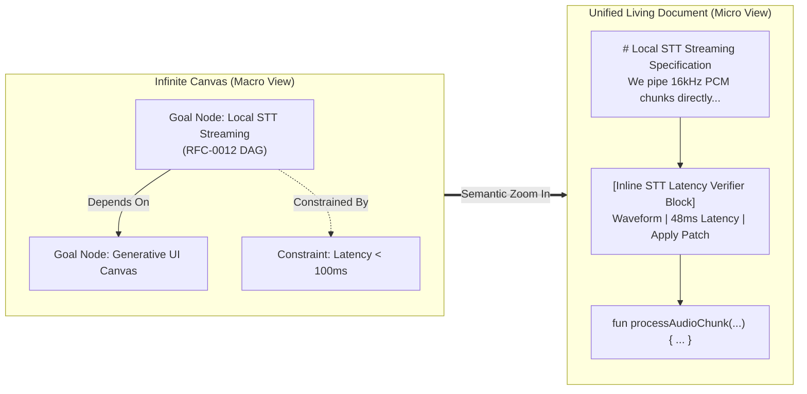
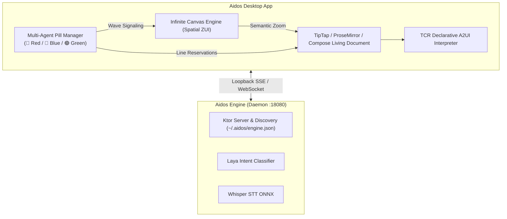

# Architectural Blueprint: Aidos Desktop & Generative UI

**Status:** Approved Architectural Direction & Blueprint  
**Date:** October 2026  
**Authors:** Aidos & Dictator Engineering  
**Related Documents:**
- [RFC-0012: Intent Graph](file:///C:/Users/jsilv/.gemini/antigravity/worktrees/aidos/generative_ui_aidos_desktop/docs/rfcs/0012-intent-graph.md)
- [RFC-0051: Desktop](file:///C:/Users/jsilv/.gemini/antigravity/worktrees/aidos/generative_ui_aidos_desktop/docs/rfcs/0051-desktop.md)
- [RFC-0103: Aidos Engine](file:///C:/Users/jsilv/.gemini/antigravity/worktrees/aidos/generative_ui_aidos_desktop/docs/rfcs/0103-aidos-engine.md)
- [LAYA: Typed Decisions](file:///C:/Users/jsilv/.gemini/antigravity/worktrees/aidos/generative_ui_aidos_desktop/LAYA.md)
- [Dictator SDK Integration Plan](file:///C:/Users/jsilv/.gemini/antigravity/worktrees/aidos/generative_ui_aidos_desktop/docs/dictator-sdk-integration-plan.md)

---

## 1. Executive Summary & Vision

This blueprint establishes the architecture for **Aidos Desktop** and its integration with **Aidos Engine** and **Dictator**.

Traditional AI developer tools fall into one of two traps:
1. **The Chat Sidebar Trap:** AI is confined to an ephemeral text side-panel, separated from the code and document.
2. **The Panel-Hell Trap:** "Generative UI" is reduced to automated window management—splitting the screen into arbitrary tiles and panes that cramp real estate and overwhelm the user.

Aidos Desktop eliminates both traps by introducing a **unified spatial and agent-native architecture**:

```
┌────────────────────────────────────────────────────────────────────────┐
│                      AIDOS DESKTOP ARCHITECTURE                        │
├────────────────────────────────────────────────────────────────────────┤
│                                                                        │
│  [MACRO STARTING POINT]  ──►  THE INFINITE INTENT CANVAS               │
│                               • 2D Spatial surface (RFC-0012 DAG)      │
│                               • Goals, constraints, architecture nodes │
│                               • Semantic zoom navigation               │
│                                                                        │
│  [MICRO SURFACE]         ──►  UNIFIED LIVING DOCUMENT                  │
│                               • Dictator voice-docked prose & code     │
│                               • Continuous, distraction-free flow      │
│                               • Zero panel splits                      │
│                                                                        │
│  [AGENT PRESENCE]        ──►  MULTI-AGENT PILLS                        │
│                               • 🔴 Red Pill: Speech & Orchestrator     │
│                               • 🔵 Blue Pill: Code & Refactor Worker   │
│                               • 🟢 Green Pill: Verifier & Test Worker  │
│                               • Canvas wave signaling ("Working here") │
│                               • Document line reservations & locks     │
│                                                                        │
│  [GENERATIVE EXECUTION]  ──►  ATOMIC INLINE TOOLS                      │
│                               • Synthesized at the point of thought    │
│                               • Assembled from TCR atomic primitives   │
│                               • Infinite parametric variations         │
│                                                                        │
└────────────────────────────────────────────────────────────────────────┘
```

---

## 2. The Architectural Split: Engine Daemon vs. Desktop Client

The runtime and UI layers are strictly decoupled:

### 2.1 Aidos Engine (`:desktopapp --daemon`)
* **Headless Background Service:** Runs on localhost port `18080`.
* **Discovery Protocol:** Publishes active connection credentials and authorized bearer token to `~/.aidos/engine.json`.
* **Inference Backends:**
  - `llama.cpp` for text generation and structured tool output.
  - ONNX Runtime for Whisper speech-to-text (`liturgos-auditor`).
  - **Laya** for sub-millisecond typed decision primitives (`choice`, `noul`, `score`).
* **Persistence:** SQLite execution kernel, model catalogs, and project state.

### 2.2 Aidos Desktop (The Generative Client)
* **Decoupled Client:** Connects to Aidos Engine via loopback HTTP/SSE/WebSocket.
* **Lightweight & Resilient:** Can be restarted, styled, or updated without halting running model processes or active background agent sessions.

---

## 3. Macro: The Infinite Intent Canvas

Rather than navigating a traditional file tree, the user begins on the **Infinite Intent Canvas**.



### 3.1 Properties of the Canvas
1. **The Intent Graph IS the Workspace:** Canvas nodes represent RFC-0012 Intent Nodes (Goals, Sub-goals, Constraints, Acceptance Criteria, Milestones).
2. **Edges as Semantic Relationships:** Edges represent dependencies, blocks, or data flows.
3. **Semantic Zoom (ZUI):**
   * **Zoom Level 0.1 – 0.3 (Galaxy View):** Architectural topology, high-level project status, and goal dependencies.
   * **Zoom Level 0.4 – 0.7 (Cluster View):** Active sub-goals, assigned agents, and milestone health.
   * **Zoom Level 0.8 – 1.0 (Focus View):** Smoothly transitions into the **Unified Living Document** for the selected node.

---

## 4. Micro: The Unified Living Document

When zooming into a canvas node, the user enters the **Unified Living Document**.

* **Prose and Code in One Flow:** Technical specifications, architectural rationale, and runnable code blocks (powered by Dictator’s TipTap/ProseMirror or Compose editor) live seamlessly in a single vertical stream.
* **Zero Panel Clutter:** No sidebars, no split bottom terminal, and no chat drawers. Everything occurs within the document context.
* **Preserved Document History & Provenance:** Dictator's provenance engine tracks human typing, voice dictation, and AI generation per block, preserving auditability.

---

## 5. Multi-Agent Pills: Spatial Presence, Waves & Line Reservations

In Aidos Desktop, **Pills are not passive text chips—they are living visual avatars and proxies for active agents**.

```
┌────────────────────────────────────────────────────────────────────────┐
│                        MULTI-AGENT PILL ROLES                          │
├───────────────────────────────┬────────────────────────────────────────┤
│ 🔴 Red Pill (Orchestrator)    │ Caret companion; speech & STT listener │
│ 🔵 Blue Pill (Worker: Code)   │ Code restructuring, refactoring, patch │
│ 🟢 Green Pill (Worker: Test)  │ Verifier, test runner, constraints check│
│ 🟣 Violet Pill (Worker: R&D)  │ Web research, documentation, media     │
└────────────────────────────────────────────────────────────────────────┘
```

### 5.1 The Red Pill: The Traveling STT & Orchestration Companion
* **Caret Tracking:** Glides smoothly alongside the user's cursor `(x, y)` as they type or dictate in the document.
* **Micro-Waveform & Streaming Preview:** Houses an animated audio waveform (`▅▆▇▃`) and streams live Whisper transcription preview before committing text to the document.
* **Task Delegation:** When the user utters a voice command (e.g. *"Hey Aidos, have the blue agent restructure this function to use coroutines"*), the Red Pill evaluates the intent via **Laya**, activates the **Blue Pill**, and dispatches the task.

```
We need to ensure that the audio buffer does not overflow during
sustained dictation sessions. [🔴 ▅▆▇▃ | "refactor this buffer logic"]
                               ▲
                               └── Red Pill (Caret STT Companion)
```

---

### 5.2 Macro Canvas Signaling: Directional Waves ("Working Here!")

When an agent is assigned a task on a canvas node (e.g., refining an architectural goal or breaking a feature into sub-goals):
1. The **Blue Pill** flies across the canvas and anchors near the target node.
2. **Directional Wave Animation:** The Blue Pill emits animated, radiating concentric waves towards the node boundary.
3. **Visual Cue:** *"I am working here!"* The user instantly observes which node is currently being processed, reasoned over, or modified.
4. **Node Activity Glow:** The node boundary pulses with the agent's color theme (blue glow).

```
┌────────────────────────────────────────────────────────┐
│  [🔵 Blue Pill] ~ ~ ~ ∿ ∿ ∿ ► ┌──────────────────────┐ │
│   (Refactor Agent)             │ Goal: Audio Buffer   │ │
│   [Evaluating Graph...]        │ Status: In-Progress  │ │
│                                └──────────────────────┘ │
│                                                         │
│   Canvas Wave Signaling: "Blue Agent is working here!" │
└────────────────────────────────────────────────────────┘
```

---

### 5.3 Micro Document Signaling: Line-Range Reservations & Live Locks

When an agent is tasked with modifying code or prose within a document:
1. The **Blue Pill** navigates directly to the target block or function.
2. **Line-Range Reservation (`Working Here` lock):**
   * The active lines (e.g., lines 42–65) are highlighted with a tinted translucent background wash (`rgba(59, 130, 246, 0.12)`).
   * An animated wave/shimmer pulses along the line-number gutter.
3. **Soft/Advisory Concurrency Lock:** Signals to the human that the agent has active temporary ownership of these lines, preventing accidental editing collisions while the agent generates or formats.
4. **Progress & Transformation:**
   * The Blue Pill displays its live sub-step: `[🔵 Structuring coroutine | 60%]`.
   * When generation completes, the line reservation smoothly unfurls into an **Atomic Inline Diff Block** with accept/reject controls or auto-merges if approved!

```
┌────────────────────────────────────────────────────────────────────────┐
│  41 | fun initializeAudioStream() {                                    │
│  42 |   // [🔵 Blue Pill: Refactoring to coroutine flow...]            │
│  43 | ~ val buffer = AudioRecord.getMinBufferSize(...)               ~ │
│  44 | ~ val flow = callbackFlow { ... }                              ~ │
│  45 | ~ emit(flow)                                                   ~ │
│  46 |   // [Line range 42-45 reserved by Blue Agent ~ ~ ~]             │
│  47 | }                                                                │
└────────────────────────────────────────────────────────────────────────┘
```

---

## 6. Generative Execution: Atomic Inline Tools

Instead of opening side panels, the Desktop Agent generates **Atomic Inline Tools** directly at the point of thought.

```
┌────────────────────────────────────────────────────────────────────────┐
│  fun allocateBuffer(sampleRate: Int): AudioBuffer {                    │
│                                                                        │
│  ┌── [AI Generated Tool: Inline Patch & Latency Check] ─────────────┐  │
│  │ Target: AudioBuffer.kt (Lines 42-55)                             │  │
│  │ - val bufferSize = sampleRate * 2                                │  │
│  │ + val bufferSize = AudioRecord.getMinBufferSize(...)             │  │
│  │ Metric: Latency -18ms | Safety: No Overflow                      │  │
│  │ [✓ Accept Patch] [✗ Reject] [Dictate Voice Feedback]             │  │
│  └──────────────────────────────────────────────────────────────────┘  │
│                                                                        │
│  }                                                                     │
└────────────────────────────────────────────────────────────────────────┘
```

---

## 7. Trusted Component Registry (TCR): Atomic Hierarchy & Variation System

To give the agent **boundless variation possibilities** without sacrificing safety or visual consistency, the TCR is structured around **Atomic Design Principles**:

```
Design Tokens (Level 0)  ──►  Atomic Primitives (Level 1)  ──►  Molecular Combinators (Level 2)
(Colors, Densities, Glass)    (Text, Waveform, Button, Diff)    (InlineCard, Split, Timeline, Slot)
```

### 7.1 The Atomic Vocabulary (Periodic Table)

| Category | Atomic Primitives (Level 1) | Description |
| :--- | :--- | :--- |
| **Agent & Voice** | `AgentPillAvatar`, `VoiceWaveform`, `AudioPill`, `WaveEmitter` | Agent presence, real-time audio signal, radiating wave canvas graphics. |
| **Typography & Data** | `TextSpan`, `Badge`, `MetricValue`, `Sparkline`, `Icon` | Data presentation primitives with tokenized typography and color semantics. |
| **Input & Action** | `ActionButton`, `ToggleSwitch`, `Slider`, `InputField`, `Chip` | Interactive controls that dispatch typed events back to the agent state machine. |
| **Code & Inspection** | `CodeLine`, `DiffChunk`, `SyntaxToken`, `LineReservation` | Fine-grained syntax and diff rendering primitives with inline accept hooks. |
| **Media & Web** | `WebSurface`, `ImageThumbnail`, `VideoCanvas` | Sandboxed display primitives for rendering web pages, previews, and media. |

### 7.2 Molecular Combinators (Layout Containers)
Combinators define how atoms nest and compose:
* `InlineCard`: Container with optional border, background tint, and collapse toggle.
* `ActionBar`: Horizontal cluster of actions aligned with flex distribution.
* `MetricCluster`: Multi-column grid for key/value metrics and sparklines.
* `SplitComparison`: Side-by-side or stacked container for before/after states.
* `CollapsibleDrawer`: Inline section that tucks secondary details away until requested.

### 7.3 The Parametric Variation Pipeline

The agent generates bespoke UI by outputting a **Declarative A2UI Manifest**. The manifest combines molecular combinators, atomic primitives, and parametric variation props:

```json
{
  "type": "InlineCard",
  "props": {
    "intent": "accent",
    "density": "compact",
    "elevation": "glass"
  },
  "slots": {
    "header": {
      "type": "Row",
      "children": [
        { "type": "AgentPillAvatar", "props": { "color": "blue", "role": "refactor" } },
        { "type": "TextSpan", "props": { "text": "Refactor: AudioBuffer Coroutine Flow", "weight": "bold" } },
        { "type": "Badge", "props": { "label": "Laya Verified", "intent": "success" } }
      ]
    },
    "body": {
      "type": "MetricCluster",
      "children": [
        { "type": "MetricValue", "props": { "label": "Latency Delta", "value": "-18ms", "delta": "better" } },
        { "type": "MetricValue", "props": { "label": "Thread Safety", "value": "Lock-Free", "delta": "neutral" } }
      ]
    },
    "footer": {
      "type": "ActionBar",
      "children": [
        { "type": "ActionButton", "props": { "label": "Accept & Merge", "actionId": "accept_patch", "intent": "primary" } },
        { "type": "ActionButton", "props": { "label": "Discard", "actionId": "discard_patch", "intent": "subtle" } }
      ]
    }
  }
}
```

---

## 8. Technology Stack & Integration Strategy



* **Client Core:** Compose Multiplatform Desktop or Web-native desktop shell (Tauri / CEF).
* **Editor Core:** Dictator's TipTap/ProseMirror text engine with caret-coordinate tracking for the floating Red Pill and line reservation highlighting for worker pills.
* **Canvas Engine:** Spatial 2D canvas with hardware-accelerated pan/zoom, node wave rendering, and semantic zoom thresholds.
* **STT Pipeline:** Direct PCM audio streaming from desktop microphone to Aidos Engine's `/v1/audio/transcriptions` via loopback WebSocket/HTTP.

---

## 9. Phased Implementation Roadmap

### Phase 1: Engine Daemon & STT Loopback (Immediate)
- Finalize `--daemon` mode in `:desktopapp` with port `18080` and `~/.aidos/engine.json` credential publishing.
- Test loopback audio streaming from Dictator microphone to Aidos Engine Whisper STT.

### Phase 2: Multi-Agent Pills & Traveling STT Companion
- Implement caret-coordinate tracking in the editor (`useCursorState`).
- Build the `TravelingSTTPill` (Red Pill) with live micro-waveform, streaming transcript preview, and caret following.
- Add worker pills (Blue/Green) with document line-reservation tinting and animated perimeter locks.

### Phase 3: Macro Canvas Wave Signaling & Atomic TCR
- Implement the 2D zoomable spatial canvas representing the RFC-0012 Intent Graph.
- Build the canvas wave emitter animation where agent pills signal active work on target nodes.
- Implement Level 1 TCR atomic primitives and the A2UI Declarative Manifest interpreter to render inline molecular tools.
