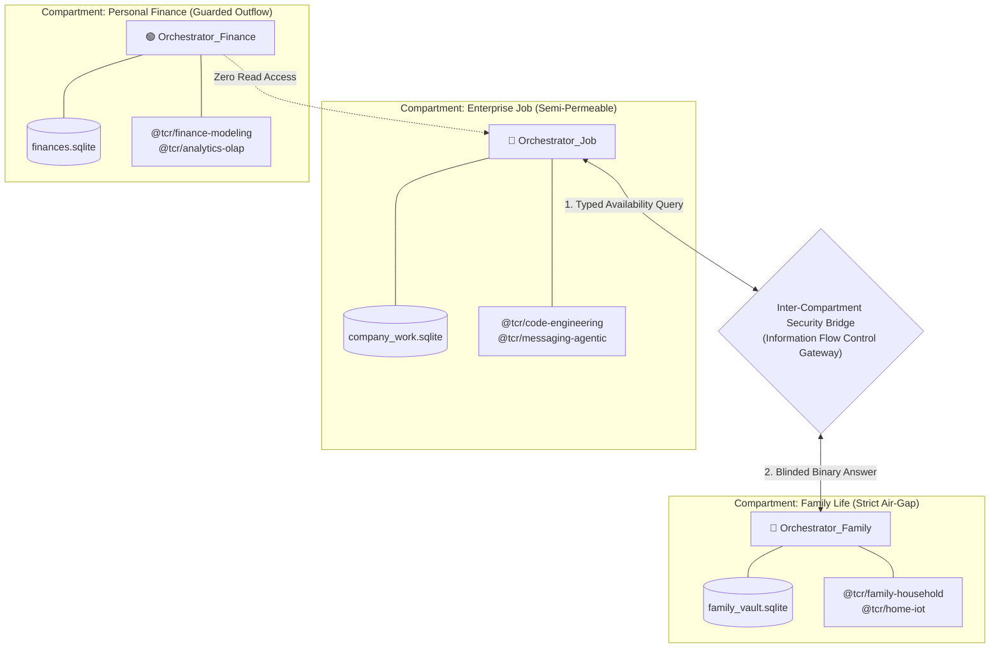

# Compartmentalization, Multi-Orchestrator Security Boundaries & Domain-Scoped TCR

**Status:** Approved Architectural Direction & Specification  
**Date:** October 2026  
**Authors:** Aidos & Dictator Engineering  
**Companion Documents:**
- [Architectural Blueprint: Aidos Desktop & Generative UI](file:///C:/Users/jsilv/.gemini/antigravity/worktrees/aidos/generative_ui_aidos_desktop/docs/research/generative-ui-aidos-desktop.md)
- [Generative UI for Research, Discovery & Everyday Knowledge Graphs](file:///C:/Users/jsilv/.gemini/antigravity/worktrees/aidos/generative_ui_aidos_desktop/docs/research/genui-research-discovery.md)
- [Generative UI for Finance, Spreadsheets & Causal Modeling](file:///C:/Users/jsilv/.gemini/antigravity/worktrees/aidos/generative_ui_aidos_desktop/docs/research/genui-financial-modeling.md)
- [Generative UI & GDPR: Data Minimization, Privacy Vaults & Local-First AI](file:///C:/Users/jsilv/.gemini/antigravity/worktrees/aidos/generative_ui_aidos_desktop/docs/research/genui-gdpr-privacy.md)
- [Aidos Messenger: Agentic Messaging Platform & Protocol](file:///C:/Users/jsilv/.gemini/antigravity/worktrees/aidos/generative_ui_aidos_desktop/docs/research/aidos-messenger-spec.md)

---

## 1. Executive Summary

As Aidos Desktop expands to encompass all 25 human computing domains—from coding and finance to smart home, family life, and enterprise jobs—two critical architectural risks emerge:
1. **Prompt Context Exhaustion (The TCR Bloat Problem):** If an agent prompt must carry schemas for all 100+ TCR components simultaneously, it degrades inference speed, bloats token consumption, and reduces tool selection accuracy.
2. **Context Bleed & Memory Poisoning (The Monolithic Agent Problem):** If a single all-seeing orchestrator manages your entire life, information from private family moments or medical logs will inevitably bleed into business emails, code commits, or cloud prompts.

This specification introduces a **Tripartite Architectural Refinement**:
1. **Domain-Scoped TCR Packaging:** Splitting the Trusted Component Registry into modular, demand-loaded packages. The orchestrator loads only universal atoms by default, dynamically hydrating domain packages only when active.
2. **Stateless Conversational Prompts (Canvas-First from the Get-Go):** Discarding rolling linear chat history. The **Canvas and its Intent DAG nodes represent the canonical state and memory**, allowing agent invocations to be lightweight, targeted, and stateless.
3. **Multi-Orchestrator Compartmentalization (Information Flow Control):** Partitioning the workspace into isolated compartments (`Family`, `Job`, `Finance`, `Public`), each governed by an independent orchestrator with strict, mathematically enforced Information Flow Control (IFC) boundaries.

```
┌────────────────────────────────────────────────────────────────────────┐
│               MULTI-ORCHESTRATOR COMPARTMENTALIZATION                  │
├────────────────────────────────────────────────────────────────────────┤
│                                                                        │
│  ┌──────────────────────────────┐      ┌────────────────────────────┐  │
│  │ COMPARTMENT: FAMILY LIFE     │      │ COMPARTMENT: ENTERPRISE JOB│  │
│  │ • Orchestrator_Family        │      │ • Orchestrator_Job         │  │
│  │ • Memory: Isolated SQLite DB │      │ • Memory: Company SQLite DB│  │
│  │ • Outflow Rule: DENY_ALL     │      │ • Outflow Rule: ALLOW_WORK │  │
│  │ • TCR: @tcr/family, @tcr/home│      │ • TCR: @tcr/code, @tcr/mcp │  │
│  └──────────────┬───────────────┘      └────────────┬───────────────┘  │
│                 │                                   │                  │
│                 │      INTER-COMPARTMENT BRIDGE     │                  │
│                 │   (Typed, Zero-PII Queries Only)  │                  │
│                 └─────────────────▲─────────────────┘                  │
│                                   │                                    │
│                 Job asks: "Is human free Thursday 16:00?"              │
│                 Family answers: "{ available: false, busy: true }"     │
│                 (Zero disclosure of kids' names or private events!)    │
│                                                                        │
└────────────────────────────────────────────────────────────────────────┘
```

---

## 2. Domain-Scoped TCR Architecture (No Context Bloat)

To keep agent prompts fast, focused, and token-efficient, the Trusted Component Registry is organized into isolated, versioned domain packages:

```
@tcr/
├── core/                  # Universal Atoms (Text, Button, Slider, Badge, Input, Card)
├── code-engineering/      # Monaco, Diff, AST, Terminal, TestRunner, OpenAPI
├── finance-modeling/      # CausalDriver, Amortization, Currency, Sankey, TaxOptimizer
├── home-iot/              # LightToggle, Thermostat, ColorHue, ScheduleTimer, SecurityCamera
├── family-household/      # ScheduleRibbon, RideLogistics, SmartGrocery, ChoreLeaderboard, MedLog
├── research-geo/          # MapCanvas, RoutePolyline, PriceMatrix, RecipeCard
├── analytics-olap/        # InterpretedChart, DuckDBSandbox, DataProfile
└── messaging-agentic/     # ConversationThread, MessageEnvelope, ApprovalModal
```

### 2.1 Dynamic Prompt Hydration via Laya
The agent does **not** receive all domain schemas upfront:
1. **Base Invariant:** Every prompt receives *only* `@tcr/core` (representing universal UI primitives: containers, text, buttons, sliders).
2. **Sub-Millisecond Domain Detection:** When the user interacts or speaks, the local **Laya** decision engine categorizes the active task domain (e.g. `HOME_AUTOMATION` vs. `FINANCIAL_ANALYSIS`) in single-digit milliseconds.
3. **Dynamic Hydration:** Only the matching package schemas (e.g. `@tcr/home-iot`) are injected into the tool context.
4. **Token Savings:** Reduces prompt schema overhead from ~12,000 tokens down to **under 800 tokens**, drastically accelerating local inference on desktop GPUs.

---

## 3. Stateless Conversational Prompting: The Canvas IS the Memory

Traditional chatbots maintain a rolling transcript of 30–50 conversational messages in the context window. This creates three critical failures:
* Massive token accumulation.
* "Attention dilution" where the LLM forgets early instructions.
* Disconnect between chat text and actual application state.

### 3.1 Dropping Conversation History: Nodes from the Get-Go
In Aidos Desktop, **we drop rolling conversation history entirely**. The user starts directly on the **Infinite Canvas with Nodes**:

```
┌────────────────────────────────────────────────────────────────────────┐
│                       LEAN AGENT PROMPT CONTEXT                        │
├────────────────────────────────────────────────────────────────────────┤
│                                                                        │
│  [1. Active Node State]   ──► Goal ID, current properties, code/text   │
│  [2. Local Neighborhood]  ──► Immediate parent/child edges in the DAG  │
│  [3. Active TCR Schemas]  ──► @tcr/core + @tcr/[active-domain]         │
│  [4. Immediate User Cue]  ──► Latest voice prompt or action intent     │
│                                                                        │
│  TOTAL PROMPT SIZE: ~1,200 TOKENS (vs. 18,000+ in legacy chat)         │
│                                                                        │
└────────────────────────────────────────────────────────────────────────┘
```

* **Memory is Spatial & Relational:** If you want to know what was decided last Tuesday, the state is recorded in the **RFC-0012 Intent Graph DAG** node, not buried on line 412 of a chat transcript.
* **Deterministic Rollback:** You can undo or branch state directly by reverting a node, with zero risk of conversational context contamination.

---

## 4. Multi-Orchestrator Compartmentalization & Information Flow Control (IFC)

A single monolithic orchestrator with global memory is a critical security vulnerability. If an orchestrator that manages your children's medical records is also used to generate marketing emails or run third-party MCP tools, prompt injection can exfiltrate sensitive family data.

### 4.1 The Compartment Model
Aidos Desktop implements strict **Information Flow Control (IFC)** by running **multiple independent Orchestrator Agent instances**, each jailed within an isolated cryptographic and storage compartment:



### 4.2 Compartment Boundary Rules:

| Compartment | Outflow Policy | External Inquiries Permitted | Inflow Policy | Primary Domain |
| :--- | :--- | :--- | :--- | :--- |
| **`Family Life`** | `DENY_ALL` (Strict Air-Gap) | Availability checks only (`BUSY/FREE`) | Strictly filtered | Kids, rides, health, home devices, private pinboards |
| **`Personal Finance`**| `DENY_EXTERNAL` | Aggregated budget totals only | Local banking feeds | Invoices, mortgages, taxes, cashflow models |
| **`Enterprise Job`** | `ALLOW_WORK_EGRESS` | Company APIs, client messaging | Public & company | Coding, PRs, technical docs, client communications |
| **`Public Research`**| `ALLOW_PUBLIC` | Full web harvesting, MCP tools | Untrusted web data | Web search, maps, price scraping, Wikipedia |

---

## 5. The Inter-Compartment Bridge Protocol

Orchestrators **never read each other’s database or memory tables directly**. When cross-compartment coordination is required, communication passes through the **Inter-Compartment Bridge**:

### 5.1 Case Study: Scheduling a Work Meeting
1. **The Request:** `Orchestrator_Job` needs to find time for an external client meeting on Friday afternoon.
2. **The Boundary Barrier:** `Orchestrator_Job` has **zero permission** to read `family_vault.sqlite` (where Sofia’s pediatric dentist appointment is recorded).
3. **The Typed Query:** `Orchestrator_Job` dispatches a strictly formatted inquiry to the Bridge:
   ```json
   {
     "requestingCompartment": "JOB",
     "targetCompartment": "FAMILY",
     "queryType": "TIME_AVAILABILITY_QUERY",
     "timeRange": {
       "start": "2026-10-24T14:00:00Z",
       "end": "2026-10-24T17:00:00Z"
     }
   }
   ```
4. **The Blinded Response:** `Orchestrator_Family` inspects the schedule and responds:
   ```json
   {
     "available": false,
     "busyIntervals": [
       { "start": "2026-10-24T15:00:00Z", "end": "2026-10-24T16:30:00Z", "status": "CONFIRMED_BUSY" }
     ]
   }
   ```
   * **Zero Information Leakage:** `Orchestrator_Job` learns only that the human is busy; it learns **nothing** about Sofia, the dentist, or the family location!

### 5.2 The Human Consent Gate for Escalated Inquiries
If `Orchestrator_Job` requests information that exceeds public boundaries (e.g., *"Provide human's personal mobile number for an urgent SMS alert"*), the Bridge intercepts the call and spawns a **Consent Gate Modal** directly to the human user on screen:
> ⚠️ **Compartment Access Request:**  
> `Orchestrator_Job` is requesting access to **Personal Mobile Number** from `Compartment: Family`.  
> `[ Grant One-Time ]` `[ Deny ]` `[ Always Mask via Relay ]`

---

## 6. Synthesis: The Unhackable, High-Speed Agentic Desktop

By combining **Domain-Scoped TCRs**, **Stateless Canvas Prompts**, and **Multi-Orchestrator Compartmentalization**:
1. **Blazing Speed:** Prompt overhead drops from ~18,000 tokens to under ~1,500 tokens, enabling lightning-fast local inference on desktop hardware.
2. **Mathematical Privacy:** Sensitive family and health memories are air-gapped from job scripts and public web scrapers.
3. **Prompt Injection Immunity:** Even if an agent in the `Job` or `Public Research` compartment suffers an indirect prompt injection attack from a malicious email or web page, it physically cannot read or compromise the `Family` or `Finance` compartments.
4. **Persistent Clarity:** You work with a clean, living spatial graph from the first second—no endless chat history to scroll through.
