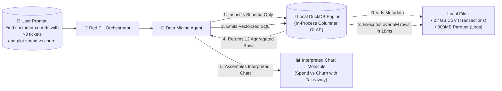
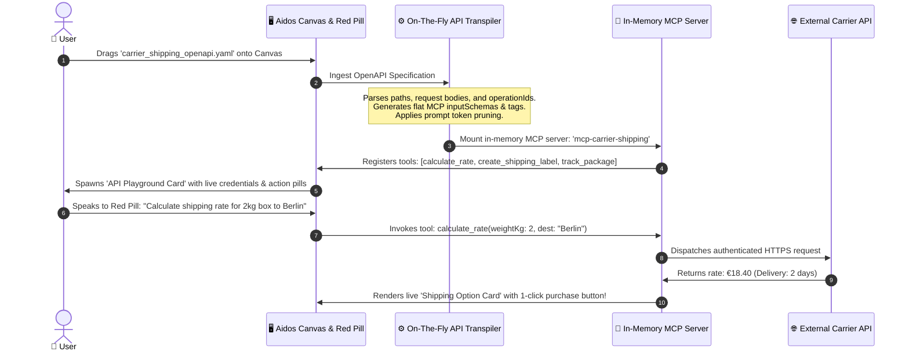

# Generative UI for Big Data Mining, In-Process Analytics & On-The-Fly MCP API Generation

**Status:** Approved Architectural Direction & Specification  
**Date:** October 2026  
**Authors:** Aidos & Dictator Engineering  
**Companion Documents:**
- [Architectural Blueprint: Aidos Desktop & Generative UI](file:///C:/Users/jsilv/.gemini/antigravity/worktrees/aidos/generative_ui_aidos_desktop/docs/research/generative-ui-aidos-desktop.md)
- [Generative UI for Research, Discovery & Everyday Knowledge Graphs](file:///C:/Users/jsilv/.gemini/antigravity/worktrees/aidos/generative_ui_aidos_desktop/docs/research/genui-research-discovery.md)
- [Generative UI for Finance, Spreadsheets & Causal Modeling](file:///C:/Users/jsilv/.gemini/antigravity/worktrees/aidos/generative_ui_aidos_desktop/docs/research/genui-financial-modeling.md)
- [Generative UI & GDPR: Data Minimization, Privacy Vaults & Local-First AI](file:///C:/Users/jsilv/.gemini/antigravity/worktrees/aidos/generative_ui_aidos_desktop/docs/research/genui-gdpr-privacy.md)
- [Aidos Messenger: Agentic Messaging Platform & Protocol](file:///C:/Users/jsilv/.gemini/antigravity/worktrees/aidos/generative_ui_aidos_desktop/docs/research/aidos-messenger-spec.md)

---

## 1. Executive Summary

This specification closes the loop on two high-leverage domains that complete the modern artificial intelligence landscape:
1. **Big Data Mining & In-Process Analytics:** Overcoming the prompt context window limitation by embedding **DuckDB** and **Parquet** directly into Aidos Desktop as a high-performance, in-process analytical engine. Millions of rows of raw CSV, JSON, and log data are queried locally in single-digit milliseconds via vectorized SQL generated by the agent, without sending private records to cloud data warehouses.
2. **On-The-Fly MCP API Generation (`openapi.yaml` ➔ MCP Server):** Eliminating the need to write custom integration code for every third-party service. When a user drags an `openapi.yaml`, Swagger JSON, or cURL command onto the Canvas, Aidos Desktop dynamically synthesizes a live, in-memory **Model Context Protocol (MCP)** server on the fly, immediately granting the traveling Red Pill and worker agents full, typed tool capabilities.

---

## 2. Big Data Mining: The In-Process Analytical Engine (DuckDB & Parquet)

### 2.1 The Context Window Bottleneck
When people attempt to use LLMs for data analysis today, they encounter a hard wall: a 1GB CSV or log file contains millions of tokens. Pasting it into an LLM causes context window exhaustion, massive latency, astronomical cloud token bills, and hallucinated mathematical sums.

### 2.2 The Aidos Solution: Code-as-a-Tool with DuckDB
In Aidos Desktop, the agent **never ingests raw bulk rows into its context window**. Instead, Aidos Desktop integrates **DuckDB** as a local in-process columnar database:



### 2.3 Automated Data Profiling & Quality Discovery Cards
When you drag a CSV, Parquet file, or SQLite dump onto the Infinite Canvas:
1. The **Data Miner Agent** automatically scans the file locally using DuckDB's `SUMMARIZE` functions.
2. It generates an **Interactive Data Profile Node** on the Canvas:
   - Row count, column data types, missing value percentages, and cardinality.
   - Outlier alerts (e.g. *"Warning: 4.2% of billing records contain negative prices"*).
   - Correlation matrix heatmap with clickable metric pairings.

---

## 3. On-The-Fly MCP API Generation (`openapi.yaml` ➔ Runtime Tool)

The greatest bottleneck in AI extensibility is manual tool authoring: writing glue-code, mapping REST routes, and configuring schema definitions.

In Aidos Desktop, **any REST API becomes an agent tool in 5 seconds**.



### 3.1 Overcoming the "Tool Context Bloat" Problem
Enterprise OpenAPI specs often contain 400+ endpoints. Exposing all 400 tools simultaneously degrades LLM accuracy and wastes prompt tokens.

**Aidos Desktop's Dynamic Pruning Solution:**
1. **Semantic Tag Slicing:** The transpiler groups tools by OpenAPI `tags` (e.g., `Billing`, `Shipments`, `Webhooks`).
2. **Intent-Driven Tool Activation via Laya:**
   - Tools remain dormant in memory.
   - When the user's inquiry relates to shipping, **Laya** activates only the `Shipments` sub-tools into the active prompt context.
3. **Parameter Scoping:** Flattens complex nested JSON schemas into human-understandable parameters with strict validation rules.

---

## 4. Autonomous Web Reaching & Data Harvesting (Browser Agent)

In addition to REST APIs, vast amounts of critical data are trapped on websites without public endpoints (real estate listings, public procurement portals, competitor price trackers, research archives).

### 4.1 The Headless Harvesting Pipeline:
1. **Headless Browser Execution:** Powered by Chromium / CEF inside Aidos Desktop.
2. **Structured Extraction Agent:** Navigates pages, interacts with search filters, and converts unstructured HTML tables and cards into clean, typed Parquet datasets.
3. **Piping to DuckDB:** The harvested data pipes directly into the local DuckDB lake, ready for immediate querying, correlation, and interpreted chart rendering.

---

## 5. TCR Data Mining & API Components

```
┌────────────────────────────────────────────────────────────────────────┐
│  ┌── [On-The-Fly MCP Tool: Carrier Shipping Gateway] ───────────────┐  │
│  │ Spec: carrier_openapi.yaml (14 Endpoints Active)                 │  │
│  │ Status: [🟢 Authenticated]  Host: https://api.carrier.com        │  │
│  │                                                                  │  │
│  │ Active Tools:                                                    │  │
│  │ • `calculate_shipping_rate`  • `create_label`  • `track_package` │  │
│  │                                                                  │  │
│  │ Quick Action Test:                                               │  │
│  │ Destination: [Berlin, Germany]  Weight: [2.0 kg]                 │  │
│  │ [⚡ Execute API Call] [View Raw Request/Response Payload]        │  │
│  └──────────────────────────────────────────────────────────────────┘  │
└────────────────────────────────────────────────────────────────────────┘
```

* **`DataProfileCard`:** Visual profile card displaying dataset metrics, null distributions, and anomaly badges.
* **`DuckDBSqlSandbox`:** Interactive SQL runner showing the agent's generated SQL, execution time (e.g., `14ms`), and output rows.
* **`OpenApiTranspilerNode`:** Canvas node for imported OpenAPI specs with tag toggles and authentication credential inputs.
* **`DynamicApiActionCard`:** Interactive form synthesized directly from an OpenAPI operation's `inputSchema` with 1-click execution.
* **`WebHarvesterStreamCard`:** Live progress card showing pages visited, structured rows extracted, and Parquet export buttons.

---

## 6. The Complete AI Use Case Taxonomy Audit

With this specification, Aidos Desktop covers the full spectrum of modern artificial intelligence capabilities:

| # | Use Case Domain | Aidos Desktop Architectural Surface | Specification Document |
| :---: | :--- | :--- | :--- |
| **1** | **Software Engineering & Code** | Living Document, traveling STT pill, inline diffs, AST, test runner | [`generative-ui-aidos-desktop.md`](file:///C:/Users/jsilv/.gemini/antigravity/worktrees/aidos/generative_ui_aidos_desktop/docs/research/generative-ui-aidos-desktop.md) |
| **2** | **Writing, Prose & Voice** | Dictator voice editor, traveling STT caret companion, AI provenance | [`generative-ui-aidos-desktop.md`](file:///C:/Users/jsilv/.gemini/antigravity/worktrees/aidos/generative_ui_aidos_desktop/docs/research/generative-ui-aidos-desktop.md) |
| **3** | **System Architecture & Strategy**| RFC-0012 Intent Graph DAG on the 2D Infinite Canvas | [`generative-ui-aidos-desktop.md`](file:///C:/Users/jsilv/.gemini/antigravity/worktrees/aidos/generative_ui_aidos_desktop/docs/research/generative-ui-aidos-desktop.md) |
| **4** | **Research, Search & Discovery** | Organic topic subgraphs, interactive maps, price matrices | [`genui-research-discovery.md`](file:///C:/Users/jsilv/.gemini/antigravity/worktrees/aidos/generative_ui_aidos_desktop/docs/research/genui-research-discovery.md) |
| **5** | **Smart Home & Physical IoT** | Home Assistant integration, lights, climate, automations | [`genui-research-discovery.md`](file:///C:/Users/jsilv/.gemini/antigravity/worktrees/aidos/generative_ui_aidos_desktop/docs/research/genui-research-discovery.md) |
| **6** | **Family Life & Household OS** | Shared calendars, ride logistics, groceries, chore boards, medication logs | [`genui-research-discovery.md`](file:///C:/Users/jsilv/.gemini/antigravity/worktrees/aidos/generative_ui_aidos_desktop/docs/research/genui-research-discovery.md) |
| **7** | **Agentic Messaging & Comms** | Aidos Messenger, MLS E2EE, progressive disclosure, H2H, H2A, A2A | [`aidos-messenger-spec.md`](file:///C:/Users/jsilv/.gemini/antigravity/worktrees/aidos/generative_ui_aidos_desktop/docs/research/aidos-messenger-spec.md) |
| **8** | **Finance & Business Modeling** | Causal financial graphs, living mortgage/runway calculators | [`genui-financial-modeling.md`](file:///C:/Users/jsilv/.gemini/antigravity/worktrees/aidos/generative_ui_aidos_desktop/docs/research/genui-financial-modeling.md) |
| **9** | **Data Visualization & Analytics**| Interpreted Chart molecules, inflection annotations, voice walkthroughs | [`genui-financial-modeling.md`](file:///C:/Users/jsilv/.gemini/antigravity/worktrees/aidos/generative_ui_aidos_desktop/docs/research/genui-financial-modeling.md) |
| **10**| **Data Privacy & GDPR** | Local-first boundary, in-flight Privacy Vault, Article 17 erasure | [`genui-gdpr-privacy.md`](file:///C:/Users/jsilv/.gemini/antigravity/worktrees/aidos/generative_ui_aidos_desktop/docs/research/genui-gdpr-privacy.md) |
| **11**| **Big Data Mining & OLAP** | DuckDB in-process engine, text-to-vectorized-SQL, data profiler | [`genui-data-mining-and-apis.md`](file:///C:/Users/jsilv/.gemini/antigravity/worktrees/aidos/generative_ui_aidos_desktop/docs/research/genui-data-mining-and-apis.md) |
| **12**| **Autonomous API Synthesis** | On-the-fly MCP generation from OpenAPI/Swagger/cURL | [`genui-data-mining-and-apis.md`](file:///C:/Users/jsilv/.gemini/antigravity/worktrees/aidos/generative_ui_aidos_desktop/docs/research/genui-data-mining-and-apis.md) |
| **13**| **Web Harvesting & Browser Agents**| Headless Chromium extraction, structured Parquet piping | [`genui-data-mining-and-apis.md`](file:///C:/Users/jsilv/.gemini/antigravity/worktrees/aidos/generative_ui_aidos_desktop/docs/research/genui-data-mining-and-apis.md) |
