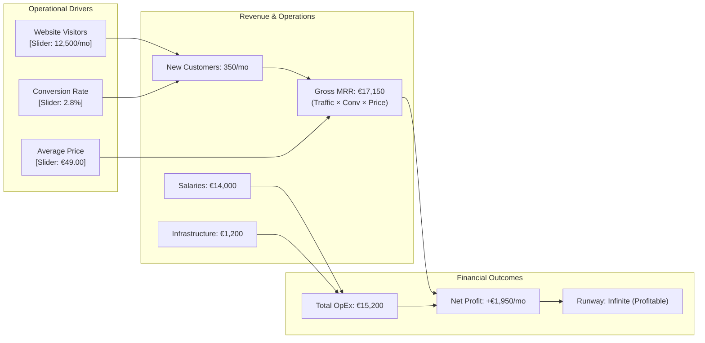

# Generative UI for Finance, Spreadsheets & Causal Modeling

**Status:** Approved Architectural Direction & Specification  
**Date:** October 2026  
**Authors:** Aidos & Dictator Engineering  
**Companion Documents:**
- [Architectural Blueprint: Aidos Desktop & Generative UI](file:///C:/Users/jsilv/.gemini/antigravity/worktrees/aidos/generative_ui_aidos_desktop/docs/research/generative-ui-aidos-desktop.md)
- [Generative UI for Research, Discovery & Everyday Knowledge Graphs](file:///C:/Users/jsilv/.gemini/antigravity/worktrees/aidos/generative_ui_aidos_desktop/docs/research/genui-research-discovery.md)
- [RFC-0012: Intent Graph](file:///C:/Users/jsilv/.gemini/antigravity/worktrees/aidos/generative_ui_aidos_desktop/docs/rfcs/0012-intent-graph.md)
- [LAYA: Typed Decisions](file:///C:/Users/jsilv/.gemini/antigravity/worktrees/aidos/generative_ui_aidos_desktop/LAYA.md)

---

## 1. The Core Critique: Why Spreadsheets are Broken

The spreadsheet grid ($A1:Z100$) was invented in 1979 (VisiCalc). For nearly five decades, computing has forced financial thinking into a rigid, 2D matrix of rectangular cells.

### The Inherent Flaws of the Traditional Spreadsheet:
1. **Cryptic Cell Coordinates:**
   - Real business and personal finances operate on **semantic variables and causal drivers**:
     $$\text{Revenue} = \text{Subscribers} \times \text{ARPU}$$
     $$\text{Net Runway} = \frac{\text{Cash Balance}}{\text{Monthly Burn}}$$
   - Spreadsheets obscure this logic behind unreadable cell formulas:
     `=SUMIFS($D$4:$D$120, $B$4:$B$120, ">=2026-01-01", $C$4:$C$120, "SaaS") * (1 - $F$2)`
   - Inserting a single row or cutting and pasting often causes silent reference errors that destroy financial integrity.
2. **Black Box Models & Low Trust:**
   - Nobody except the original author understands how a 15-tab Excel model works.
3. **The Disconnect Between Narrative and Data:**
   - Financial decisions require **context**: *Why did we set churn at 2.5%? What assumption was made about inflation?*
   - Today, the assumptions live in Word, the model lives in Excel, and the summary lives in PowerPoint.
4. **How Legacy AI Misses the Point:**
   - Modern tools (like Microsoft Copilot in Excel) simply bolt a chat drawer next to the spreadsheet that writes Python or VBA. You remain trapped in the same fragile grid.

---

## 2. The Transformed UI: Causal Financial Graphs & Living Documents

In **Aidos Desktop**, finance is transformed through the **Macro Canvas** and **Micro Living Document** architecture:

```
┌────────────────────────────────────────────────────────────────────────┐
│                   AIDOS GENERATIVE FINANCIAL UI                        │
├────────────────────────────────────────────────────────────────────────┤
│                                                                        │
│  [MACRO LEVEL: THE CAUSAL FINANCIAL GRAPH]                             │
│  • Financial logic is a dynamic DAG on the 2D Canvas (RFC-0012)        │
│  • Nodes = Operational Drivers, Revenue Streams, Expenses, Runway      │
│  • Edges = Mathematical & causal dependencies                          │
│  • Sliders propagate calculation waves in real time                    │
│  • What-If scenario branching side-by-side without duplicating sheets  │
│                                                                        │
│  [MICRO LEVEL: NARRATIVE COMPUTATIONAL DOCUMENTS]                      │
│  • Financial plans written in Dictator prose alongside live numbers    │
│  • Dynamic semantic tables (named columns, zero A1:B2 coordinates)     │
│  • Reactive inline tools: Mortgage Simulators, Cashflow Sankeys,       │
│    Invoice Builders, Tax Optimization Cards                            │
│                                                                        │
│  [INTERPRETED CHARTS: NARRATIVE DATA VISUALIZATION]                    │
│  • No naked charts: Every curve is accompanied by executive takeaways │
│  • Coordinate annotations directly on inflection points and anomalies  │
│  • Attribution drill-down drawers and probability forecast ribbons     │
│  • Synchronous voice audio walkthrough via the traveling Red Pill      │
│                                                                        │
│  [VOICE REASONING VIA TRAVELING RED PILL]                              │
│  • "What if we increase price by €5 and marketing by 10%?"             │
│  • Red Pill runs goal-seeking and highlights sensitivity drivers       │
│                                                                        │
└────────────────────────────────────────────────────────────────────────┘
```

---

## 3. Macro: The Causal Financial Graph

Instead of hidden Excel formulas across 20 tabs, business models and household budgets are represented as **Causal Graphs on the Infinite Canvas**:



---

## 4. Interpreted Charts: Narrative Data Visualization Beyond Raw Curves

A chart without context is a cognitive burden. Users must squint at peaks and troughs, guessing why revenue dropped or whether an anomaly is seasonal noise.

In Aidos Desktop, we enforce a strict design rule: **"No Naked Charts"**. Every chart generated by an agent is an **Interpreted Chart Molecule (`InterpretedChartCard`)**.

```
┌────────────────────────────────────────────────────────────────────────┐
│  ┌── [Interpreted Chart: MRR Growth & Churn Diagnosis] ─────────────┐  │
│  │                                                                  │  │
│  │ 💡 Executive Takeaway:                                           │  │
│  │ "MRR increased +14.2% in October to €17,150. However, customer    │  │
│  │ acquisition cost rose 28%. At current churn, growth plateaus in  │  │
│  │ January unless top-of-funnel conversion improves."               │  │
│  │                                                                  │  │
│  │ €20k ┼                                              / ── [P90]   │  │
│  │      │                               [📍 Oct 1: Price Increase]  │  │
│  │ €15k ┼                                     ●─────● ─── [P50]     │  │
│  │      │                       ●───────────●'       \ ── [P10]     │  │
│  │ €10k ┼          [📍 June 14: Outage]                             │  │
│  │      │          ●                                                │  │
│  │  €5k ┼──────────┴──────────────────────────────────────────────  │  │
│  │     May        Jun          Jul          Aug    Sep    Oct (Forecast)│
│  │                                                                  │  │
│  │ [🔍 Attribution Waterfall] [🎲 Monte Carlo Forecast] [▶ Listen] │  │
│  └──────────────────────────────────────────────────────────────────┘  │
└────────────────────────────────────────────────────────────────────────┘
```

### 4.1 The Anatomy of an Interpreted Chart Molecule:

1. **Executive Takeaway Badge (Natural Language TL;DR):**
   * Placed prominently at the top of the card.
   * Explains **what happened**, **the primary causal driver**, and **the strategic consequence**.
2. **Coordinate Inflection Annotations (The "Why" Pins):**
   * Stamped directly on the data curve at critical inflection points.
   * Examples:
     - `📍 June 14: Server outage caused 18% churn dip`
     - `📍 Sept 1: Self-serve pricing tier launched (+€3.2k ARR)`
     - `⚠️ Anomaly: 3.4σ spike in Sunday traffic (Likely scraper bot)`
3. **Attribution Decomposition Drawer:**
   * Clicking any point on the curve expands a **Waterfall Attribution Breakdown**:
     - $\Delta \text{ MRR} = +€2,150$:
       - New Customers: $+€1,400$
       - Expansion Upgrades: $+€1,100$
       - Churn & Contraction: $-€350$
4. **Forecast Confidence Ribbons:**
   * Distinguishes historical ground truth (solid line) from agent projections (dashed line with shaded $P10 / P50 / P90$ probability fan).
   * Interactive goal-seeking: Dragging the target curve endpoint backward recalculates required conversion drivers!
5. **Synchronous Voice Walkthrough (Traveling Red Pill):**
   * Clicking `[▶ Listen]` or asking the Red Pill: *"Walk me through this chart"* triggers a 15-second audio briefing.
   * As the Red Pill speaks, the corresponding segments and annotations on the chart illuminate in synchronized harmony.

---

## 5. Micro: Narrative Computational Documents (Decipad / Causal Style)

When zooming into a financial node, you enter the **Micro Living Document**, where financial models are expressed as human narratives with embedded reactive calculations:

```
┌────────────────────────────────────────────────────────────────────────┐
│  # 2027 Family Home Purchase Plan                                      │
│  We are aiming to buy an apartment in Töölö or Lauttasaari by Q2 2027. │
│  We currently have €45,000 saved, and our joint monthly savings is     │
│  €1,350.                                                               │
│                                                                        │
│  ┌── [AI Generated Tool: Interactive Mortgage & Amortization] ──────┐  │
│  │ Target Apartment Price: [€340,000]                               │  │
│  │ Down Payment: [€68,000 (20%)]  Loan Required: [€272,000]         │  │
│  │ Interest Rate (Euribor 12m + Margin): [====●=== 3.2%]            │  │
│  │ Loan Term: [25 Years]                                            │  │
│  │                                                                  │  │
│  │ Monthly Payment: €1,318/mo                                       │  │
│  │ Total Interest Over 25 Years: €123,400                           │  │
│  │                                                                  │  │
│  │ [Stress Test: +1.5% Interest Rate]  [Simulate Extra Amortization]│  │
│  └──────────────────────────────────────────────────────────────────┘  │
│                                                                        │
│  To reach the €68,000 down payment goal, we need €23,000 more. At our  │
│  current savings rate of €1,350/mo, we will reach the goal in 17 mos.  │
└────────────────────────────────────────────────────────────────────────┘
```

---

## 6. Trusted Component Registry (TCR): Financial & Chart Archetypes

| Category | TCR Component | Description |
| :--- | :--- | :--- |
| **Atoms** | `CurrencySpan` | Locale-aware currency (`€1,250.00`), inflation toggle, currency conversion. |
| **Atoms** | `DriverSlider` | Dynamic parameter slider with min/max, step, and logarithmic curves. |
| **Atoms** | `RunwayGauge` | Visual gauge of cash runway with safety thresholds (Green > 12m, Amber 6–12m, Red < 6m). |
| **Atoms** | `MetricTrendBadge` | Visual delta indicators (`+18.4% YoY` green, `-3.2% MoM` red). |
| **Atoms** | `ChartAnnotationPin` | Contextual coordinate marker anchored to $(x, y)$ data point on a curve. |
| **Molecules** | `InterpretedChartCard` | High-level chart molecule with executive takeaway, annotations, forecast ribbon, and voice playback. |
| **Molecules** | `CausalDriverCard` | Modular card displaying input variables, English formula, and live output. |
| **Molecules** | `SankeyCashflowDiagram` | Visual cash flow waterfall (Income $\to$ Expenses $\to$ Savings/Taxes). |
| **Molecules** | `DynamicSemanticTable` | Named-column table with type safety (zero cell coordinates). |
| **Molecules** | `InvoiceGeneratorCard` | Generates compliant invoices with itemized hours, VAT calculation, and 1-tap PDF export. |
| **Molecules** | `SubscriptionAuditorCard` | Scans receipts/statements for recurring charges, flags price hikes, and drafts 1-tap cancellation emails. |

---

## 7. Declarative A2UI Schema: Interpreted Chart Molecule

```json
{
  "nodeId": "chart_mrr_growth",
  "title": "MRR Growth & Churn Attribution",
  "category": "FINANCIAL_CHART",
  "ui": {
    "type": "InterpretedChartCard",
    "props": {
      "chartType": "line_with_forecast",
      "executiveTakeaway": "MRR increased +14.2% in October to €17,150. However, CAC rose 28%. Growth will plateau by January unless conversion improves.",
      "audioNarrationAvailable": true
    },
    "data": {
      "series": [
        { "date": "2026-05-01", "mrr": 5200, "isHistorical": true },
        { "date": "2026-06-01", "mrr": 6800, "isHistorical": true },
        { "date": "2026-06-14", "mrr": 6100, "isHistorical": true, "annotation": "Server outage (-18% retention)" },
        { "date": "2026-07-01", "mrr": 9200, "isHistorical": true },
        { "date": "2026-08-01", "mrr": 12400, "isHistorical": true },
        { "date": "2026-09-01", "mrr": 15000, "isHistorical": true, "annotation": "Self-serve pricing launch (+€3.2k)" },
        { "date": "2026-10-01", "mrr": 17150, "isHistorical": true },
        { "date": "2026-11-01", "mrr": 18400, "isHistorical": false, "p10": 16900, "p90": 20100 },
        { "date": "2026-12-01", "mrr": 19200, "isHistorical": false, "p10": 17100, "p90": 22300 }
      ]
    },
    "actions": [
      { "label": "Decompose Drivers (Waterfall)", "actionId": "open_waterfall" },
      { "label": "Listen to Briefing", "actionId": "play_chart_audio" }
    ]
  }
}
```

---

## 8. Voice Goal-Seeking via the Traveling Red Pill

Because the financial model is a semantic DAG rather than dumb numbers:
* **The User Speaks:** *"Hey Aidos, what price do we need to charge to reach €50k MRR by December without increasing marketing spend?"*
* **The Red Pill Evaluates:** It runs mathematical goal-seeking over the DAG, identifies the critical sensitivity driver, and pulses the `[Average Price]` card on the canvas:  
  `"To reach €50k MRR with current conversion rates, you must raise average price from €49 to €62."`
* **Zero Spreadsheet Clutter:** No goal-seek popups, no broken macros, no lost context.
