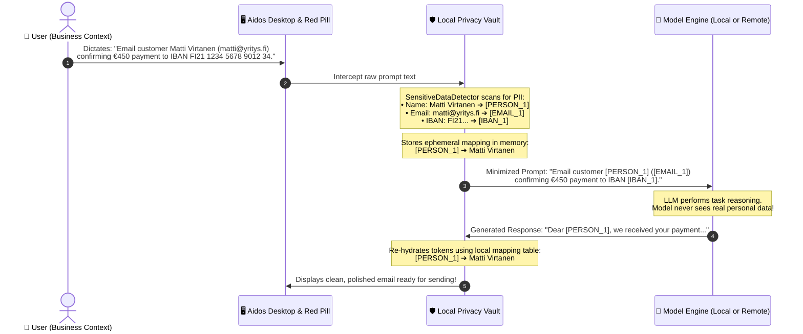

# Generative UI & GDPR: Data Minimization, Privacy Vaults & Local-First AI

**Status:** Approved Architectural Direction & Specification  
**Date:** October 2026  
**Authors:** Aidos & Dictator Engineering  
**Companion Documents:**
- [Architectural Blueprint: Aidos Desktop & Generative UI](file:///C:/Users/jsilv/.gemini/antigravity/worktrees/aidos/generative_ui_aidos_desktop/docs/research/generative-ui-aidos-desktop.md)
- [Generative UI for Research, Discovery & Everyday Knowledge Graphs](file:///C:/Users/jsilv/.gemini/antigravity/worktrees/aidos/generative_ui_aidos_desktop/docs/research/genui-research-discovery.md)
- [Generative UI for Finance, Spreadsheets & Causal Modeling](file:///C:/Users/jsilv/.gemini/antigravity/worktrees/aidos/generative_ui_aidos_desktop/docs/research/genui-financial-modeling.md)
- [RFC-0012: Intent Graph](file:///C:/Users/jsilv/.gemini/antigravity/worktrees/aidos/generative_ui_aidos_desktop/docs/rfcs/0012-intent-graph.md)
- [LAYA: Typed Decisions](file:///C:/Users/jsilv/.gemini/antigravity/worktrees/aidos/generative_ui_aidos_desktop/LAYA.md)

---

## 1. Executive Summary & The European Reality

In the European Union, the **General Data Protection Regulation (GDPR)** and the **EU AI Act** establish strict legal requirements around personal data processing. For AI applications, traditional cloud models present immense compliance hazards:
* **Context Window Pollution:** Users paste emails, customer records, contracts, and medical questions into prompts.
* **Violation of Article 5(1)(c) (Data Minimisation):** Cloud models receive far more personal data than strictly necessary to perform the task.
* **The "Unlearning" Impossibility:** Once personal data is fed into cloud model training pipelines or multi-tenant memory stores, fulfilling an Article 17 **"Right to Erasure"** request is technically impossible.

**Aidos Desktop** turns privacy from a compliance headache into a competitive superpower. Built on a **local-first foundation**, Aidos Desktop introduces an automated **Data Minimization & In-Flight Pseudonymization Gateway (The Privacy Vault)** that strips personal identifiers before inference and rehydrates them locally on screen.

Furthermore, by distinguishing between **Business Workspaces** (strict GDPR compliance by default) and **Personal/Household Workspaces** (relaxed convenience with guarded health/child zones), Aidos Desktop adapts seamlessly to professional and domestic life.

```
┌────────────────────────────────────────────────────────────────────────┐
│                   AIDOS GDPR PRIVACY ARCHITECTURE                      │
├────────────────────────────────────────────────────────────────────────┤
│                                                                        │
│  [LOCAL-FIRST BOUNDARY]                                                │
│  • Aidos Engine runs on 127.0.0.1:18080 (100% offline inference)       │
│  • Zero cross-border data transfers to foreign cloud servers           │
│                                                                        │
│  [THE PRIVACY VAULT: IN-FLIGHT PSEUDONYMIZATION]                       │
│  • Detects PII: Names, Emails, Phones, IBANs, Finnish HETUs, Addresses │
│  • Masks PII into semantic tokens: [PERSON_A], [IBAN_A] before prompt   │
│  • Model reasons over tokens; Vault re-hydrates text locally on screen │
│  • The AI model never sees or retains the actual personal data         │
│                                                                        │
│  [INTENT GRAPH ARTICLE 17 ERASURE]                                     │
│  • Local model weights are frozen; data lives in SQLite & Intent Graph │
│  • 1-Click "Right to be Forgotten" cascades across the DAG, scrubbing   │
│    personal attributes while preserving aggregate accounting balances  │
│                                                                        │
└────────────────────────────────────────────────────────────────────────┘
```

---

## 2. Dual-Persona Workspaces: Business vs. Personal

```
┌──────────────────────────────────────┬──────────────────────────────────────┐
│  BUSINESS / ENTERPRISE WORKSPACE     │  PERSONAL / HOUSEHOLD WORKSPACE      │
├──────────────────────────────────────┼──────────────────────────────────────┤
│ • Strict GDPR Article 25 by default  │ • Household exemption (Art. 2(2)(c)) │
│ • Automated in-flight PII masking    │ • Relaxed typing of family names     │
│ • Ephemeral session retention (30d)  │ • Permanent memories & photo boards  │
│ • Article 15/17 compliance auditor   │ • "Guarded Zones" for health/kids    │
│ • Formal Data Processing Agreements  │ • Local-only lock on special category│
└──────────────────────────────────────┴──────────────────────────────────────┘
```

### 2.1 Business Mode: Strict GDPR Compliance by Default
* **Purpose:** For freelancers, SMEs, legal teams, and enterprises processing customer, patient, or employee data.
* **Zero-PII Ingress/Egress:** Any data leaving the local machine (or entering an agent prompt) is aggressively minimized and pseudonymized.
* **Automated Retention Schedules (Article 5(1)(e)):** Transcripts and task attempts auto-purge after declared retention windows (e.g., 30 or 90 days).
* **Cryptographic Article 17 Deletion Certificate:** When a customer record is deleted, Aidos generates a verifiable cryptographic receipt proving erasure.

### 2.2 Personal & Household Mode: Natural Flow with Guarded Zones
* Under GDPR Article 2(2)(c), personal and household activities are exempt from strict GDPR requirements. You can freely dictate your kids' names, personal notes, or recipes without frustrating consent barriers.
* **The "Guarded Zones" Safeguard (Article 9 Special Category Data):**
  - Even in personal mode, **Health & Medication Logs**, **Financial Banking IBANs**, and **Child Identity Data** are designated as *Guarded Zones*.
  - Guarded data is locked exclusively to the local Aidos Engine. If an external tool or cloud model is invoked, the Red Pill displays a **Privacy Shield Modal** requiring explicit confirmation.

---

## 3. The Privacy Vault: In-Flight Pseudonymization & De-Anonymization

The **Privacy Vault** acts as a local security middleware sitting between user input and model execution:



### 3.1 Benefits of the Vault:
1. **Mathematical Data Minimization (Article 5(1)(c)):** Only non-identifiable structural tokens are processed.
2. **Zero Training Exposure:** Cloud providers and logs capture only `[PERSON_1]` and `[EMAIL_1]`.
3. **Frictionless Human Experience:** The human sees the real names on their screen; the masking and unmasking happen transparently in single-digit milliseconds.

---

## 4. Solving the "Right to be Forgotten" (Article 17) in AI

Traditional generative AI models suffer from the **"Model Memorization Trap"**: if an LLM is fine-tuned on customer support logs, there is no mathematical method to reliably delete a single customer's data without retraining the entire model from scratch at massive expense.

### The Aidos Architectural Solution:
1. **Separation of Model and Memory:**
   - The inference model (`llama.cpp`) is **strictly frozen and weights-only**. It never stores user memories in its weights.
   - All knowledge, customer interactions, and intent nodes live in the **RFC-0012 Intent Graph and SQLite relational store**.
2. **Deterministic Cascading Erasure:**
   - When a data subject requests erasure, Aidos Desktop initiates an **Article 17 DAG Cascade**:
     ```
     [ Customer Node: Matti Virtanen ] ──► ERASED
             │
             ├──► [ Invoice Node #402 ] ──► PII Scrubbed, Financial Totals Retained
             ├──► [ Support Transcript ] ──► Purged from SQLite
             └──► [ Vector Embeddings ] ──► Embeddings containing PII dropped
     ```
   - **Legal Compliance:** Invoices retain necessary financial numbers for national tax compliance (e.g., Finnish Tax Administration 6-year retention rule), but all personal identifiers are severed.

---

## 5. TCR Privacy Components: Visual Affordances

Privacy in Aidos Desktop is an active, tactile part of the UI:

### 5.1 Privacy Atoms & Molecules

```
┌────────────────────────────────────────────────────────────────────────┐
│  To: [PERSON_1 ▾ "Matti Virtanen"] <[EMAIL_1 ▾ "matti@yritys.fi"]>     │
│  Subject: Payment Confirmation for Invoice #402                        │
│                                                                        │
│  Dear Matti, we have received your payment of €450.00 to our account.  │
│                                                                        │
│  ┌── [🛡️ Privacy Shield: 3 PII Tokens Masked] ──────────────────────┐  │
│  │ Level: [High Minimization]  Target Engine: [Local llama.cpp]     │  │
│  │ [Matti Virtanen ➔ PERSON_1] [matti@yritys.fi ➔ EMAIL_1]         │  │
│  │ [✓ Pass Pseudonymized] [Unmask for Local Engine]                 │  │
│  └──────────────────────────────────────────────────────────────────┘  │
└────────────────────────────────────────────────────────────────────────┘
```

* **`PrivacyShieldBadge`:** A glowing shield on the traveling Red Pill indicating real-time PII detection count (`[🛡️ 3 items masked]`).
* **`DataMinimizationSlider`:** A 3-step slider:
  - *Level 1 (Strict Pseudonymization):* All names, emails, phones, IBANs, and dates of birth replaced with tokens.
  - *Level 2 (Smart Minimization):* Identifiers masked; operational context (e.g. city, role) preserved.
  - *Level 3 (Pass-Through):* Full raw text allowed only for local 100% offline backends.
* **`PiiInspectionDiff`:** A side-by-side modal displaying what the human typed vs. the sanitized tokenized prompt sent to the engine.
* **`Article17ErasureModal`:** A guided wizard that scans the Intent Graph for all references to an individual and executes verifiable deletion.

---

## 6. Declarative A2UI Schema: Privacy Inspection Card

```json
{
  "nodeId": "privacy_shield_audit",
  "title": "Data Minimization & PII Filter",
  "category": "PRIVACY_SECURITY",
  "ui": {
    "type": "InlineCard",
    "props": { "intent": "success", "elevation": "glass" },
    "slots": {
      "header": {
        "type": "Row",
        "children": [
          { "type": "Icon", "props": { "name": "shield-check", "intent": "success" } },
          { "type": "TextSpan", "props": { "text": "GDPR Data Minimization Active", "weight": "bold" } },
          { "type": "Badge", "props": { "label": "3 Tokens Masked", "intent": "success" } }
        ]
      },
      "body": {
        "type": "Column",
        "children": [
          {
            "type": "Row",
            "children": [
              { "type": "TextSpan", "props": { "text": "Detected PII Entities:", "weight": "medium" } }
            ]
          },
          {
            "type": "MetricCluster",
            "children": [
              { "type": "MetricValue", "props": { "label": "Full Name", "value": "Matti Virtanen ➔ [PERSON_1]" } },
              { "type": "MetricValue", "props": { "label": "Email Address", "value": "matti@yritys.fi ➔ [EMAIL_1]" } },
              { "type": "MetricValue", "props": { "label": "Bank IBAN", "value": "FI21... ➔ [IBAN_1]" } }
            ]
          }
        ]
      },
      "footer": {
        "type": "ActionBar",
        "children": [
          { "type": "ActionButton", "props": { "label": "Confirm & Run In-Flight Masking", "actionId": "confirm_pseudonymize", "intent": "primary" } },
          { "type": "ActionButton", "props": { "label": "View Raw Prompt Diff", "actionId": "view_diff", "intent": "subtle" } }
        ]
      }
    }
  }
}
```

---

## 7. Synthesis: Privacy as an Architectural Superpower

By embedding GDPR data minimization natively into Aidos Desktop:
1. **Local-First Independence:** Running Aidos Engine on localhost `127.0.0.1:18080` eliminates illegal cross-border transfers and Article 28 vendor chains.
2. **Zero Cognitive Friction:** The user writes normally; the Privacy Vault masks data before inference and restores it locally on screen.
3. **Deterministic Erasure:** Article 17 "Right to be Forgotten" is solved cleanly via the persistent Intent Graph DAG without complex model retraining.
4. **Adaptive Context:** The system is strictly compliant for business client records, yet warm and flexible for personal family life.
