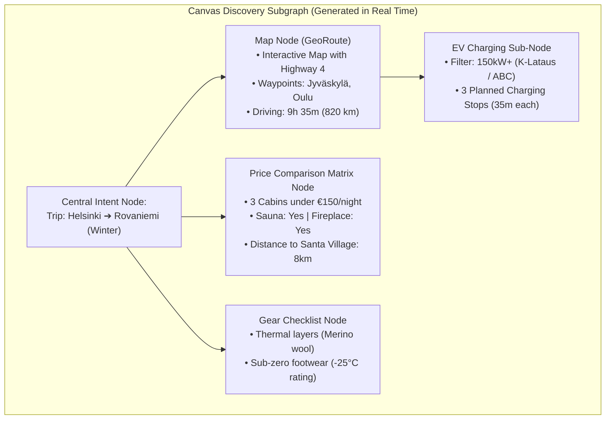

# Generative UI for Research, Discovery & Everyday Knowledge Graphs

**Status:** Approved Architectural Direction & Specification  
**Date:** October 2026  
**Authors:** Aidos & Dictator Engineering  
**Companion Documents:**
- [Architectural Blueprint: Aidos Desktop & Generative UI (Editing & Core)](file:///C:/Users/jsilv/.gemini/antigravity/worktrees/aidos/generative_ui_aidos_desktop/docs/research/generative-ui-aidos-desktop.md)
- [RFC-0012: Intent Graph](file:///C:/Users/jsilv/.gemini/antigravity/worktrees/aidos/generative_ui_aidos_desktop/docs/rfcs/0012-intent-graph.md)
- [LAYA: Typed Decisions](file:///C:/Users/jsilv/.gemini/antigravity/worktrees/aidos/generative_ui_aidos_desktop/LAYA.md)

---

## 1. Executive Summary

While code and technical writing represent high-value engineering workflows, **Research, Discovery, and Everyday Life** (trip planning, price comparison, smart home control, family logistics, recipes, and health triage) constitute the vast majority of human interactions with artificial intelligence.

Current AI assistants still trap everyday life inside linear chat boxes:
* Comparing products yields a flat, unfilterable markdown table.
* Adjusting living room lights or setting a dinner schedule requires navigating complex nested menus or remembering rigid voice syntax.
* Family coordination is scattered across five disconnected apps (WhatsApp, Google Calendar, Notes, Wilma school portal, Home Assistant).

In **Aidos Desktop**, discovery and household coordination are **spatial, graph-native, and generative**:
1. When you say *"Find about XYZ"* or *"Set up the living room for movie night and see what's for dinner"*, the **Red Pill (Orchestrator)** spawns an **Organic Everyday Knowledge Graph on the 2D Canvas**.
2. Nodes on the canvas are **specialized interactive micro-applications** from the Trusted Component Registry (TCR): Home Assistant device cards, interactive maps, price matrices, family schedule ribbons, chore boards, and medication trackers.
3. The **Red Pill Timeline HUD** maintains constant temporal anchorability (reading past conversation or glancing at condensed "cue words").
4. Zooming into any node opens its **Micro Living Document**, where high-resolution media, full specifications, and Dictator voice notes reside.

---

## 2. The Red Pill Timeline HUD: Conversational History & Cue Words

A critical principle of human cognition is that **reading and auditory comprehension require a timeline**. The user must always be able to re-read past exchanges or follow the line of inquiry without losing their place on the canvas.

```
┌────────────────────────────────────────────────────────────────────────┐
│                   RED PILL DYNAMIC TIMELINE HUD                        │
├────────────────────────────────────────────────────────────────────────┤
│                                                                        │
│  [MODE A: FULL TRANSCRIPT STREAM]                                      │
│  14:02 You: "Find winter cabins in Rovaniemi under €150 with a sauna"   │
│  14:03 Aidos: "Found 4 cabins; mapped route from Helsinki with EV stops"│
│                                                                        │
│  [MODE B: CONDENSED CUE-WORDS SCROLLER]                                │
│  [14:02: Helsinki ➔ Rovaniemi] ─► [EV 150kW+] ─► [Cabins < €150] ─► [Sauna Filter: ON]
│                                                                        │
└────────────────────────────────────────────────────────────────────────┘
```

* **Mode A (Full Transcript Stream):** When you want to read past exchanges, review agent decisions, or replay spoken audio snippets.
* **Mode B (Cue-Words Ticker):** A slim horizontal strip of high-signal semantic chips.
* **Spatial Camera Bookmarking:** Clicking any cue-word chip smoothly flies the 2D canvas camera directly to the graph node that was created during that turn.

---

## 3. How "Find about XYZ" Works: The Organic Discovery Graph

When the user speaks or types an exploratory query, the **Red Pill** decomposes the inquiry and dispatches the task. The canvas immediately sprouts a structured, multi-dimensional topic subgraph.



---

## 4. Smart Home & Home Assistant TCR: Physical Environment Control

Connecting Aidos Desktop directly to **Home Assistant** (via local WebSocket/REST API) transforms the desktop into an intelligent environmental controller. The agent composes physical device controls on demand:

```
┌────────────────────────────────────────────────────────────────────────┐
│  ┌── [Living Room Environmental Control] ───────────────────────────┐  │
│  │ Lights: [● Warm Ambient]  Brightness: [====●=== 65%]            │  │
│  │ Color Temp: [2700K Warm White] [Palette: Relax | Movie | Focus]  │  │
│  │ Climate: [21.5°C ➔ Target: 22.0°C] [Mode: Comfort] [Humidity: 45%]│  │
│  │ [Schedule: Dim to 20% at 22:30] [Scene: "Movie Night" Activated] │  │
│  └──────────────────────────────────────────────────────────────────┘  │
└────────────────────────────────────────────────────────────────────────┘
```

### 4.1 Smart Home TCR Primitives & Molecules

#### Lighting & Ambiance
* `LightToggleSwitch`: Fast, responsive on/off toggle with state feedback.
* `BrightnessSlider`: 0–100% dimming with smooth logarithmic visual curve.
* `ColorTempSlider`: Warm white (2200K) to cool daylight (6500K) gradient slider.
* `ColorHueWheel` & `PaletteChips`: RGB color picker with quick mood presets (`Candlelight`, `Relax`, `Aurora`, `Reading`).
* `RoomLightingCard`: Compound card grouping all lights in an area (Living Room, Kitchen, Kids' Room) with master and individual controls.

#### Climate & Air Quality
* `ThermostatDial`: Circular or horizontal slider displaying current ambient temp, target setpoint, and heating/cooling state.
* `ClimatePresetSelector`: Mode pills (`Eco`, `Comfort`, `Sleep`, `Away`, `Boost`).
* `AirQualityGauge`: Real-time PM2.5, CO2 (ppm), and humidity indicators with clean health thresholds.

#### Schedules, Automations & Timers
* `TimeSchedulePicker`: Visual 24-hour timeline with sunrise/sunset reference anchors.
* `AutoOffTimerPill`: e.g., *"Turn off sauna in 45 min"* with live countdown ring.
* `AutomationRuleCard`: Human-readable trigger card:  
  `When [Front door opens] after [Sunset] ➔ Turn on [Hallway Lights (40%)]`.

#### Power, Security & Access
* `PowerConsumptionSparkline`: Live wattage draw + daily kWh cost estimator.
* `SmartLockControl`: Locked/unlocked status with slide-to-unlock gesture confirmation.
* `DoorWindowSensorBadge`: Binary status pill for contact sensors (`Front Door: Closed`, `Balcony: Open`).
* `CameraSnapshotStream`: Low-latency RTSP/HLS stream with motion detection alert badges.

---

## 5. Family Life & Household Logistics TCR: The Shared Home OS

A modern family is a collaborative, high-bandwidth operating system. Aidos Desktop provides specialized TCR components to coordinate household life with warmth, clarity, and zero stress:

```
┌────────────────────────────────────────────────────────────────────────┐
│                        FAMILY LIFE TCR MODULES                         │
├───────────────────────────────┬────────────────────────────────────────┤
│ 📅 Family Calendar & Rides    │ "Who is driving whom and when?"        │
│ 🛒 Smart Groceries & Pantry   │ Aisle-categorized list + voice add     │
│ 🍽️ Meal Planning & Dinner Vote│ Weekly dinner board + family polling   │
│ ⭐ Kids' Chores & Homework    │ Chore cards, star streaks, Wilma digest│
│ 💊 Family Medication & Health │ Dose schedules, temperature logs       │
│ 📍 Safe Arrival & Presence    │ Privacy-first status pills ("At school")│
│ 📌 Shared Fridge Pinboard     │ Drawings, voice memos, photo memories  │
└────────────────────────────────────────────────────────────────────────┘
```

### 5.1 The Shared Family Calendar & Ride Logistics
* **`FamilyScheduleRibbon`:** Horizontal multi-track day/week view with color-coded avatars for each family member (Mom, Dad, Sofia, Leo).
* **`RideLogisticsCard`:** Solves the daily transportation puzzle:
  `[🚗 Dad] picks up [👧 Sofia] from [Gymnastics @ 18:00] ➔ Home`.
* **`ConflictAlertPill`:** Proactively flags scheduling collisions: *"Alert: Leo's dentist appointment conflicts with Sofia's pickup at 16:30"*.

### 5.2 Smart Groceries & Pantry Depletion
* **`SmartGroceryChecklist`:** Voice-augmented list categorized automatically by supermarket aisle (Produce, Dairy, Bakery, Frozen, Household).
* **`VoiceQuickAddPill`:** Add items directly via the traveling Red Pill: *"Hey Aidos, add oat milk and rye bread to the grocery list"*.
* **`StoreSyncBadge`:** Instant one-click QR code / sync to open the checklist in Dictator Mobile at the supermarket.
* **`PantryDepletionTracker`:** Tracks staples that run out periodically (coffee, olive oil, dishwasher tablets) with one-tap replenishment.

### 5.3 Meal Planning & Dinner Consensus ("What's for dinner?")
* **`WeeklyMealBoard`:** Mon–Sun meal cards linked directly to recipes in the TCR.
* **`FamilyVoteWidget`:** When the family can't decide, the agent presents 3 options based on pantry ingredients:
  `[🍝 Quick Pesto Pasta] vs [🍲 Salmon Soup] vs [🌮 Taco Night]`  
  Family members tap to cast their votes!
* **`AutoGrocerySyncButton`:** Tapping *"Add Week's Meals to Grocery List"* automatically extracts missing ingredients into the grocery checklist.

### 5.4 Kids' Chores, Homework & School Digests
* **`ChoreLeaderboardCard`:** Gamified visual cards with kid avatars, checkboxes, and reward star stamps (e.g. Empty dishwasher, Walk the dog).
* **`StreakCounterPill`:** Motivation streaks (e.g., *"Reading practice: 7 day streak! 🔥"*).
* **`HomeworkTracker`:** Visual card listing subjects, tasks, and due dates.
* **`SchoolNoticeDigest`:** Automatically digests school messages (e.g., Wilma portal announcements in Finland) into concise action pills:  
  *"Tomorrow is outdoor ski day — pack warm gloves, skis, and hot tea!"*

### 5.5 Family Health & Medication Log
* **`MedicineScheduleCard`:** Manages family illness logs:  
  `Antibiotics (Leo): Dose 2 of 3 given at 14:15. Next dose due at 20:15.`
* **`FeverLogSparkline`:** Timestamped temperature chart showing fever curves and medication effects.
* **`EmergencyContactPill`:** One-tap emergency pills (Poison Control, Pediatrician, Health Advice 116117).

### 5.6 Family Presence & Safe Arrival ("Where is everyone?")
* **`FamilyPresenceBadge`:** Privacy-first, non-creepy status pills:  
  `[Dad: Office]`, `[Sofia: School (Arrived 08:15)]`, `[Leo: Daycare]`.
* **`BatteryWarningPill`:** Subtle alert if a child's phone battery drops below 15% while traveling home.

### 5.7 Shared Family Fridge Pinboard (The Warmth & Memories Layer)
* **`FamilyPinboardCanvas`:** A digital corkboard on the canvas hosting:
  - Scanned kids' drawings and art.
  - Sticky voice notes (*"Don't forget Mom's birthday surprise this Friday!"*).
  - Favorite photos from recent trips.

---

## 6. Declarative A2UI Schema: Home Assistant & Family Nodes

### 6.1 Home Assistant Room Control Node
```json
{
  "nodeId": "node_living_room_ha",
  "title": "Living Room Environment",
  "category": "SMART_HOME",
  "ui": {
    "type": "InlineCard",
    "props": { "intent": "accent", "elevation": "raised" },
    "slots": {
      "header": {
        "type": "Row",
        "children": [
          { "type": "Icon", "props": { "name": "sofa", "intent": "accent" } },
          { "type": "TextSpan", "props": { "text": "Living Room (Home Assistant)", "weight": "bold" } },
          { "type": "Badge", "props": { "label": "All 4 Lights On", "intent": "success" } }
        ]
      },
      "body": {
        "type": "Column",
        "children": [
          {
            "type": "Row",
            "children": [
              { "type": "LightToggleSwitch", "props": { "entityId": "light.living_room_ceiling", "state": "on" } },
              { "type": "BrightnessSlider", "props": { "entityId": "light.living_room_ceiling", "value": 70 } },
              { "type": "ColorTempSlider", "props": { "entityId": "light.living_room_ceiling", "kelvin": 2700 } }
            ]
          },
          {
            "type": "ThermostatDial",
            "props": {
              "entityId": "climate.living_room",
              "currentTemp": 21.4,
              "targetTemp": 22.0,
              "mode": "comfort"
            }
          }
        ]
      },
      "footer": {
        "type": "ActionBar",
        "children": [
          { "type": "ActionButton", "props": { "label": "Activate Movie Scene", "actionId": "scene_movie", "intent": "primary" } },
          { "type": "ActionButton", "props": { "label": "Goodnight (Off All)", "actionId": "scene_goodnight", "intent": "subtle" } }
        ]
      }
    }
  }
}
```

### 6.2 Family Dinner Consensus & Grocery Node
```json
{
  "nodeId": "node_family_dinner_vote",
  "title": "Wednesday Dinner Decision",
  "category": "FAMILY_LOGISTICS",
  "ui": {
    "type": "InlineCard",
    "props": { "intent": "neutral", "elevation": "glass" },
    "slots": {
      "header": {
        "type": "Row",
        "children": [
          { "type": "Icon", "props": { "name": "utensils", "intent": "accent" } },
          { "type": "TextSpan", "props": { "text": "Tonight's Dinner Consensus", "weight": "bold" } }
        ]
      },
      "body": {
        "type": "FamilyVoteWidget",
        "props": {
          "options": [
            { "id": "opt_tacos", "title": "Taco Night", "votes": ["Sofia", "Leo"], "prepMinutes": 20 },
            { "id": "opt_soup", "title": "Creamy Salmon Soup", "votes": ["Mom"], "prepMinutes": 30 },
            { "id": "opt_pasta", "title": "Spinach Pesto Pasta", "votes": ["Dad"], "prepMinutes": 15 }
          ]
        }
      },
      "footer": {
        "type": "ActionBar",
        "children": [
          { "type": "ActionButton", "props": { "label": "Confirm Tacos & Add Missing to Groceries", "actionId": "confirm_tacos", "intent": "primary" } }
        ]
      }
    }
  }
}
```

---

## 7. Synthesis: The Complete Aidos Desktop Ecosystem

Aidos Desktop unifies three critical dimensions of modern life into one spatial, generative OS:
1. **The Professional Dimension:** Agentic code editing, technical writing, RFCs, and Intent Graph management with traveling STT companions and multi-agent pills.
2. **The Discovery Dimension:** Organic research subgraphs, interactive maps, product comparisons, recipes, and health triage.
3. **The Household Dimension:** Smart home environmental control via Home Assistant and family logistics (calendars, rides, groceries, chores, medicine schedules, fridge pinboard).

Everything lives on the **Infinite Canvas**, transitions seamlessly into **Unified Living Documents**, and is controlled by your **Traveling STT Companion**.
