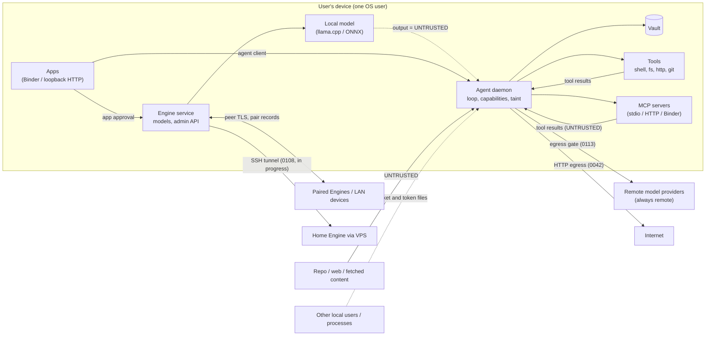

# Aidos Threat Model

**Status:** living document. Written 2026-11-16 from the code on `main`, not from RFC status lines.
Every control below names the class that implements it and the test that exercises it. Where the
code does not do what an RFC says, the row says so and the item is listed in
[section 6](#6-known-gaps-and-accepted-risks) and in the findings list.

**Related:** [RFC-0003 Security](rfcs/0003-security.md) (the design; its Threat Model section is
the primary-threat summary), [decisions.md](decisions.md) (D47 limits and locality, taint rules),
[RFC-0027](rfcs/0027-trust-and-taint.md) for taint levels.

---

## 1. Scope and assets

Aidos is a local-first agent runtime. A desktop Engine and an Android app hold models, run an
agent loop over the user's projects, call tools, and may reach other Engines and remote model
providers. The threat model covers the runtime, the Engine service, the Agent daemon, the
Android host, the SDK, and the links between them. It does not cover the security of the
operating system, the user's browser, or third-party MCP servers' own internals.

What is protected:

| Asset | Why it matters | Where it lives |
|---|---|---|
| Project content (source, documents) | The user's work, and for `personal` and `life` projects, private data | Project directories, project database |
| Air-gapped project data | Must not leave the device except through the egress gate | Bridge policies (`isEgressAirGapped`) |
| Secrets (API keys, git credentials, SSH keys) | Give access to other systems | Vault (`agent/vault`) |
| Model files | Large, licensed, and a code-execution surface when parsed | Engine model store (`engine/models`, `engine/modelruntime`) |
| The right to act through tools | Shell, network, file writes, and app IPC are effects in the user's name | Capability manager (`agent/capability`) |
| Connection tokens (daemon socket, Engine admin, app and LAN device tokens) | Each one is authority over the runtime | Token files under the user profile, pair records, app approvals |
| Approval decisions | Only the human may grant authority | Approval gates (`agent/ui-common`, `agent/bridge`) |

## 2. Trust boundaries

Boundaries that matter most:

- **Model output and tool results are UNTRUSTED.** Anything the model reads that came from the
  network, MCP, shell output, or a dependency tree can steer it. Ordinary project file reads are
  PROJECT (no approval). See `decisions.md`, taint rules.
- **Apps are clients, not principals.** An app gets only what its approval record says.
- **Peers are other people's devices.** Trust is decided by pair records and group certificates,
  never by the TLS layer.
- **Remote providers are remote.** A remote model is always marked `remote` and goes through the
  egress gate.

## 3. Attackers

| # | Attacker | Capability | Goal |
|---|---|---|---|
| A1 | Author of content the agent reads (file, web page, issue, dependency README) | Writes text the model will read | Make the model run a tool, exfiltrate data, or edit outside the project |
| A2 | Hostile or compromised app on the same device | Can call the Engine's loopback HTTP or Binder endpoints; can claim any package name | Use the user's models and tools without approval |
| A3 | Hostile MCP server | Returns tool results and descriptions | Inject instructions; receive secrets it was not given |
| A4 | Device on the same LAN | Can reach the LAN listener | Pair without the user, or send requests as a paired device |
| A5 | Network attacker, including a DNS operator | Controls DNS answers and HTTP redirects | Use the Engine as an SSRF proxy to internal addresses |
| A6 | Malicious or tampered model file | Supplies a GGUF or ONNX file | Exploit the parser, or substitute a model the user did not choose |
| A7 | Compromised paired peer | Holds a valid pair record and a group certificate | Use the Engine beyond what the user allowed for that peer |
| A8 | Thief with the device | Physical access, possibly locked | Read vault secrets and project data |
| A9 | Hostile remote model provider | Returns model output | Same as A1, plus receives whatever was sent to it |
| A10 | Other local user or process on the same machine | Can read files the user can read, if permissions allow | Read the daemon socket or the admin token |

Attacker A1 (prompt injection) is the primary threat, as in RFC-0003, because reading untrusted
text is the normal work of the agent.

## 4. Attack paths and controls

Each row gives the control, the place it lives, the test that proves it, and the residual risk.
"Not on main" means the fix is written and tested as a patch but has not been merged.

| # | Attacker | Path | Control | Where | Proof | Residual risk |
|---|---|---|---|---|---|---|
| 1 | A1 | Injected text makes the model run shell, network, app IPC, or an unsafe-recovery operation | Such operations map to `REQUIRES_APPROVAL`; out-of-project mutation and `SECRETS_READ` map to `DENY`; applied per run taint in `validate` (RFC-0027 (`rfcs/0027-trust-and-taint.md`): UNTRUSTED runs are denied `SECRETS_READ` and approval-class operations) | `agent/capability/.../TaintAttenuation.kt`, `SqliteCapabilityManager.kt` (~L300-340) | `agent/capability` `CapabilityTest`; `agent/executor` `GuardianApprovalEndToEndTest`; `agent/daemon` `ShellToolIntegrationTest`, `McpSecurityRegressionTest` | An ALLOW operation inside the project runs without a prompt. Injected text can still push the model into wrong edits the user must review. Approval fatigue is a human risk. |
| 2 | A1, A3 | Injected text or MCP output asks for a secret | `SECRETS_READ` is denied outright for UNTRUSTED runs. The redactor replaces credential values in tool results with markers and withholds a result only when it is credential-shaped (a PEM key, four or more matches, or a `.env`-style assignment file; RFC-0035 "Secrets found in content"), and redacts at prompt, event, log, memory, and export. The Engine's own agent loop (desktop and Android) applies the same rule to every tool result (`SecretToolResultScreen`) | `TaintAttenuation.kt`; redactor in `agent/vault` and the prompt/event layers; `engine/agenthost/.../SecretToolResultScreen.kt` | `DaemonVaultGateTest`; `McpSecurityRegressionTest`; `EngineToolsTest` | Redaction is pattern-based. A secret in an unfamiliar format can pass through. A credential in an unusual format, alone in an ordinary source file, is not seen by the screener and reaches the model unchanged; it was not seen before this change either. A matched value is replaced, not the file, so the model keeps the file's text. |
| 3 | A2 | Android app calls the Engine over Binder as a package it is not | Binder transport checks package name and signing-certificate pin before binding and again after | `agent/mcp-binder-android/.../AndroidBinderConnector.kt` (client side); `AmpPairTest` (androidTest, CI-only compile) | `AmpPairTest` wrong-pin case | On main, the Engine's app approval is keyed by package name only. Signer pinning of approvals is in patch 0003, **not on main** ([finding F3](#findings)). |
| 4 | A2, A10 | Local process reads the daemon socket and calls the runtime | Socket lives in a 0600 path, the connection token is written 0600, and the server refuses calls without the token. `user_interactive` cannot be set by a script | `agent/daemon/.../RuntimeSocketServer.kt`; `agent/api` `SocketPaths` | `SocketRuntimeApiRoundTripTest`; `DaemonVaultGateTest` | The token comparison on main is not constant-time (`RuntimeSocketServer.kt` has no `MessageDigest.isEqual`). Patch 0004 fixes this, **not on main**. Any process running as the same user can read the token; that is accepted, because it is the same trust level as the user. |
| 5 | A2, A10 | A stolen or leaked Engine admin token | Admin routes are installed only on the loopback listener (`AdminRoutes.kt`, "Install inside the authenticated block of the loopback listener only") | `engine/enginehost/.../http/AdminRoutes.kt`; token written to `~/.aidos/engine.json` by `DesktopEngineHost.kt` | Engine HTTP hardening tests (`EngineHttpServerHardeningTest`) | **The admin token lives 365 days** (`DesktopEngineHost.kt:271`, `validityDurationSeconds = 86400 * 365`). Any process that reads the file has admin for a year. Plan 6 replaces it with a per-start, loopback-only token. **Finding F1.** |
| 6 | A5 | SSRF: the model or a tool reaches internal addresses (`169.254.169.254`, `127.0.0.1`, RFC-1918, CGNAT) | Pre-DNS: IP literals rejected unless granted, scheme limited to http/https, default ports 80/443. Post-DNS: loopback, link-local, private and CGNAT (`100.64.0.0/10`, `EgressSecurityPolicy.kt` ~L385) refused unless the scope allows private addresses. Default scope is no private addresses | `agent/http/.../EgressSecurityPolicy.kt`, `EgressClient.kt` | `EgressSecurityPolicyTest` (for example "rejects IP literal 169_254_169_254 pre-DNS") | See row 7. |
| 7 | A5 | DNS rebinding: a name answers a public address to the policy and a private one to the connection | Policy classifies addresses from its own lookup (`dnsResolver`). The JDK `HttpClient` in `EgressClient.kt` then resolves the name again when it connects. The two lookups are not tied together | `EgressSecurityPolicy.kt`, `EgressClient.kt` | None for rebinding on main | **Open on main.** The classified address is not the connected address. Plan 4 part A (connect to the checked IP with the original name for TLS). **Finding F2.** |
| 8 | A5 | Redirect to another host carries credentials or reaches an internal address | `HttpClient.Redirect.NEVER`; policy-driven redirects; default scope is `SAME_HOST_ONLY`. Each hop is validated again from step 1 | `EgressClient.kt` (line 85), `EgressSecurityPolicy.kt` | `EgressSecurityPolicyTest` | Cross-origin credential stripping and POST-to-GET rules (patch 0006) are **not on main**. Cross-host redirects are refused on main, so the exposure is small. |
| 9 | A1, A9 | Air-gapped project data sent to a remote provider or internet | Personal and life projects are air-gapped. Bridge policy `isEgressAirGapped(projectId, kind)` decides. Egress to remote models goes through the 0113 gate (`EgressGateCoordinator`) with a privacy filter (`PrivacyFilter.kt`) | `agent/bridge/.../EgressGateCoordinator.kt`, `BlindedQueryModels.kt`; `agent/prompt/.../PrivacyFilter.kt`; `agent/executor/.../RemoteModelEgressTool.kt` | `BridgeDaemonWiringTest` ("a personal project is air-gapped"; policy decisions per project) | The 0113 **daily blinded-query budget** per project is not on main (patches 0007 and 0008, **not on main**). **Finding F5.** |
| 10 | A6 | Tampered or substituted model file | Downloads are checked against the catalogue SHA-256 (`ModelFileDigests.kt`, `DownloadManager`). A mismatch is refused | `engine/modelruntime/.../ModelFileDigests.kt`; `engine/downloads` | Digest tests in `engine/models` and `engine/downloads` | The digest proves the file matches the catalogue entry, not that the catalogue is honest. A mismatched file is currently deleted per RFC-0022; quarantine (plan 5) is not built. The GGUF/ONNX parser is native code and a memory-safety surface. **Findings F4 and F6.** |
| 11 | A4, A7 | Unpaired device on the LAN pairs or guesses a pairing code | Pairing codes are eight digits. A code burns after `maxAttempts` (5) wrong guesses. A global failure counter slows all attempts | `engine/enginehost/.../lan/ExternalDeviceGrants.kt` | `LanPairingEndToEndTest`, `LanSharingTest` | Per-source lockout (patch 0001) is **not on main**. The global cap can block a legitimate pairing for a minute when several addresses guess (plan 4 part B). **Finding F7.** |
| 12 | A7 | Peer presents a valid TLS certificate but is not trusted | The TLS trust manager accepts only self-signed certificates whose signature verifies, and says nothing about trust. `TrustStore` decides from pair records and group certificates | `engine/aidin/.../PeerTls.kt`, `TrustStore.kt`, `PeerLink.kt` | `PeerLinkTest` | Trust is only as good as the pair record. Group identity for peer clusters does not exist yet, so a peer cluster is treated as remote (D47). |
| 13 | A7 | A paired peer uses the Engine beyond its grant | Peer scopes and locality limits per peer (D47, RFC-0107). Peers are remote until a group identity exists | `engine/aidin`, `engine/enginehost` control and admin routes (`/v1/admin/peers`) | `PeerLinkTest` and routing tests (`PolicyInferenceRouterTest`) | Patch 0003 (app approval pinning) and the Android handshake are not on main. |
| 14 | A8 | Thief reads vault secrets from a locked device | Vault starts locked and unlocks with a passphrase (`AIDOS_VAULT_PASSPHRASE`) or from an OS keystore: Secret Service, Keychain, or DPAPI. The owner-only file fallback is reported as weaker | `agent/vault/.../SqliteSecretsVault.kt`, `KeyProviders.kt`, `DesktopVault.kt` | `DaemonVaultGateTest` ("starts locked, refuses a wrong passphrase") | The Android host runs its own vault since 2026-11-19 (`EngineVault`): sealed records in app-private `files/secrets/vault.json`, key non-exportable in the Android Keystore, no user authentication (the foreground service needs tokens with the screen off), so a thief who can run code as the app on an unlocked phone can still resolve them. The Keystore part has not been run on a device yet. Finding F8 closed. |
| 15 | A9 | Remote model provider receives more than the user allowed | Remote is always `remote`; default placement is `local_only`; wider placement must be explicit (D47). Egress passes the privacy filter and the 0113 gate | `agent/routing/.../PolicyInferenceRouter.kt`; `agent/executor/.../RemoteModelEgressTool.kt` | `PolicyInferenceRouterTest` | Filter quality limits what it can remove. |
| 16 | A2 | App approves its own action, or the model writes an approval | Approval is a human decision recorded by the gate. The model has no tool that approves. Guardian approval is end to end tested | `agent/executor`, `agent/ui-common/.../ApprovalGatePresenter.kt` | `GuardianApprovalEndToEndTest` | Depends on the UI showing the real request. |
| 17 | A3 | MCP server runs code or reads more than it should | MCP transport is classified by effect and permission (`agent/mcp-policy`); MCP results are UNTRUSTED; shell and app IPC need approval | `agent/mcp-policy`, `agent/mcp-core`, `agent/mcp-broker` | `McpSecurityRegressionTest`, `McpToolBrokerIntegrationTest` | **No sandbox.** An MCP server process runs with the user's privileges. RFC-0043 (plugin sandbox) is unscheduled. **Finding F9.** |
| 18 | A6, A3 | Denial of service: huge response, idle stream, runaway loop | Response size and body deadline checks in egress (patch 0006 for the deadline); stream idle timeout in the local runtime (aidos#138); loop round-trip limits | `EgressClient.kt`, `engine/modelruntime` | `EgressSecurityPolicyTest` (size); engine stream tests | Body deadline and bounded audit list are **not on main** (patch 0006). |
| 19 | A8 | A stolen Android phone with a model and a project | Android app sandbox and device lock. Secrets (Hugging Face token, provider API keys) are in the app vault under a Keystore key; models and project data are protected by the OS only | Android host, `engine/androidapp/.../vault/EngineVault.kt` | `RecordSecretsVaultTest` (JVM); device test pending | Project data and models are covered only by the OS. Device run is pending (`docs/android-fgs-device-test.md`). |

## 5. Invariants

These must always hold. Each is a sentence a test can check. Where no test exists yet, it is
named in section 6.

1. **Human approval never comes through the model.** No tool the model can call approves an
   action. (Rows 1, 16.)
2. **An UNTRUSTED run is never granted `SECRETS_READ`.** (Row 2.)
3. **Out-of-project mutation is denied, never approved.** (Row 1.)
4. **An air-gapped project's data leaves the device only through the 0113 gate, and within its
   daily budget.** The budget half is not yet on main. (Rows 9, F5.)
5. **A remote model is always marked `remote`.** (Row 15.)
6. **A model file whose digest does not match is never loaded.** (Row 10. Loaded refusal is
   tested; quarantine is not.)
7. **An admin token is accepted only on the loopback listener.** Holds structurally today
   (row 5); the explicit peer-address check and a per-start token are plan 6. (Rows 5, F1.)
8. **A peer is trusted only through its pair record or group certificate, never by the TLS layer
   alone.** (Row 12.)
9. **An egress request reaches only the address that policy checked.** Not true on main. (Row 7, F2.)
10. **A redirect never leaves the original host on main.** Holds today; the credential rule is
    patch 0006. (Row 8.)
11. **The vault is locked until its passphrase or keystore key is provided.** (Row 14.)
12. **A pairing code burns after a fixed number of wrong guesses.** (Row 11.)

## 6. Known gaps and accepted risks

**Designed but not built or not on main**

- **RFC-0043 plugin sandbox.** MCP servers and plugins run with the user's privileges. Unscheduled.
  Accepted until a plugin ecosystem exists. (Row 17.)
- **Group identity for peer clusters.** Until it exists, peer clusters are remote (D47). (Row 13.)
- **Android Keystore for the vault: device run.** Built 2026-11-19 (RFC-0035 amendment 10), tested on the JVM only; the Keystore key has not been exercised on a phone. (Row 14.)
- **Node key in Keystore.** Not yet built (project memory; not re-checked in code).
- **Patches for trust, vault, egress, bridge and pairing** (review fixes 0001 to 0008). Written
  and tested, not on main. Plan 1 lands them. Findings F3, F5, F7 depend on it.
- **Egress DNS pinning** (plan 4 part A). Finding F2.

**Fixes landing now, which this document will be updated against**

- Plan 5: quarantine of a model file with a wrong digest (RFC-0022 amendment first).
- Plan 6: per-start, loopback-only desktop admin token (RFC-0115 amendment first).

**Accepted on purpose**

- A process running as the same OS user can read the daemon token and the owner-only Engine file.
  The same user already owns the data; a stronger boundary would need a second OS account.
- Redaction is pattern based. The user can always type a secret into a prompt themselves.
- The model itself can make a wrong edit inside the project. Review of diffs is the control, and
  it is the user's job.
- The desktop tray and installers are not exercised in the cloud. Their security tests are the
  real desktop run in `docs/desktop-services-e2e.md`.

## Findings

Findings from writing this document. Each one either becomes a plan or is listed as accepted.

| ID | Severity | Finding | Where | Plan |
|---|---|---|---|---|
| F1 | High | Desktop admin token is valid for 365 days and persists in `~/.aidos/engine.json`. Any reader of that file has admin for a year. | `DesktopEngineHost.kt:271`, `EngineDiscovery.kt` | Plan 6 |
| F2 | Medium | DNS rebinding: the egress policy classifies one lookup and the JDK client connects on another. | `EgressSecurityPolicy.kt`, `EgressClient.kt` | Plan 4 A |
| F3 | Medium | Android app approval is keyed by package name, with no signing-certificate pin. Patch 0003 is not on main. | Android handshake, `AppApprovalStore` | Plan 1 (patches 0002, 0003) |
| F4 | Medium | The RFC-0022 digest rule deletes a mismatched model file and does not keep it for diagnosis. Juha's decision is to quarantine. | `engine/downloads`, `engine/modelruntime` | Plan 5 |
| F5 | Medium | The 0113 daily blinded-query budget per project is not in code. Patches 0007 and 0008 are not on main. | `agent/bridge` | Plan 1 |
| F6 | Low | The model parser (llama.cpp, ONNX) is native code fed by a file the user chose. No sandboxing of parsing. | `engine/modelruntime` | Accepted for now; revisit with the plugin sandbox |
| F7 | Low | The llama.cpp native libraries come from one third-party fork (`net.ladenthin:llama` 6.0.0, a single-maintainer project) as Maven Central classifier jars, and the loader extracts them to a temp directory and loads them. Android takes them from the `llama-android` AAR. A compromised release would run native code in the Engine process. Vulkan and the other GPU modules are loaded only if a driver is present and add the vendor driver as native surface. | `engine/modelruntime/build.gradle.kts`, `engine/androidapp/build.gradle.kts` | Versions are pinned exactly. Not yet done: verify the jar digests in the build (Gradle dependency verification) |
| F7 | Low | Pairing: the global failure cap can refuse a legitimate pairing for a minute. Per-source lockout (patch 0001) is not on main. | `ExternalDeviceGrants.kt` | Plan 1, plan 4 part B |
| F8 | High (Android) | ~~The Android host runs no vault, so secrets there lack the keystore protection the desktop has.~~ Closed 2026-11-19: the host keeps its secrets in `EngineVault` (Android Keystore key) and migrates the old plaintext preferences. The Engine agent loop now screens tool results for credentials too (RFC-0035 amendment 11). | Android host, `agent/vault` | Done; device run pending |
| F9 | Medium | MCP servers run unsandboxed, with user privileges. | `agent/mcp-*` | RFC-0043, unscheduled |
| F10 | Low | The daemon socket token compare is not constant-time on main. | `RuntimeSocketServer.kt` | Plan 1 (patch 0004) |
| F11 | Low | The vault schema tolerance fix (patch 0005, apply the whole schema and tolerate only "already exists") was not found on main. | `agent/vault/.../SqliteSecretsVault.kt` | Plan 1 (patch 0005). Confirm before closing. |

## 7. Keeping this document current

Update this file in the same PR when a change does any of these:

- adds, removes, or changes a trust boundary, a listener, or a transport (Binder, loopback HTTP,
  LAN, SSH tunnel, egress client);
- adds or changes a credential, a token's lifetime or location, or a pair record;
- changes what an effect or permission maps to in `TaintAttenuation`, or the taint rules in
  `decisions.md`;
- adds a model source, a loader, or a parser;
- adds a tool or a plugin that runs code.

Add the matching row to section 4 with its test, and a line to section 6 if a control is partial.
The review checklist in `CLAUDE.md` carries this rule.
